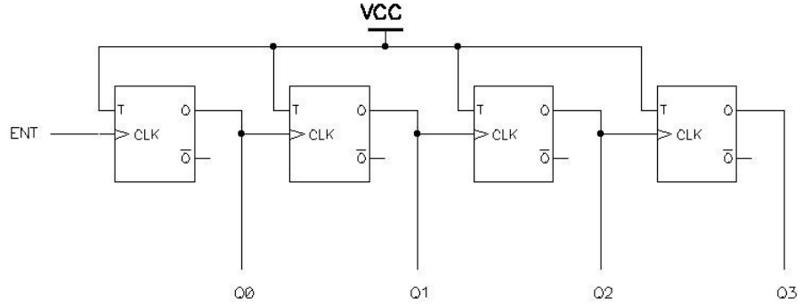
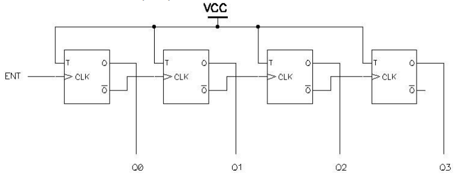
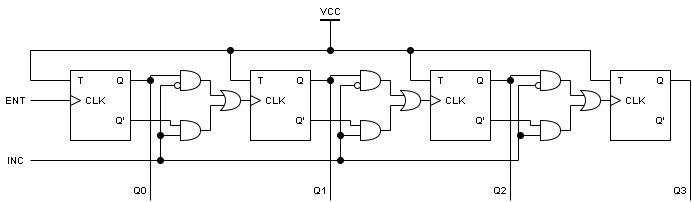

# Contador con incremento y decremento

**Fecha:** 14-10-2026

## Consigna

    Utilizando flip-flops y compuertas lógicas, construir un contador de 4 bits, con una entrada adicional: si está en 1 lo incrementa y si está en 0 lo decrementa.

## Resolución

La resolución para este ejercicio es bastante sencilla considerando lo que ya construimos en el teórico.
Recordemos que sabemos construir un contador de cualquier cantidad de bits ascendente o descendente, a continuación mostramos las imágenes de los circuitos correspondientes con FF tipo T.

**Descendente**

**Ascendente**

Estos circuitos ya hacen lo más complejo que necesitamos: a partir de cualquier número de 0 a 15 el ascendente incrementa la cuenta, mientras que el descendiente la decrementa.
La cuestión que tenemos que resolver es como hacemos para elegir entre un incremento o un decremento en cada momento.

> En definitiva, queremos que cuando la entrada INC=1 el circuito se comporte como el circuito ascendente; mientras que cuando la entrada INC=0 queremos que se comporte como el descendente.

Esto es muy fácil de reflejar en un nuevo circuito, de la siguiente forma:

Donde lo único que cambia es la conexión entre la salida de los FF y las entradas CLK de los siguientes en la cascada; justamente por como queremos que se comporte el circuito.

Para finalizar el ejercicio, aclaramos que tenemos que hacer para agregar funcionalidad de reset al circuito.

> Bastaría con conectar esta señal a las señales de reset de cada FF individualmente, reestableciendo cada salida a cero.

Esto concluye el ejercicio.