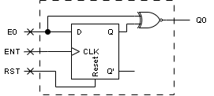

# Comparador serial de bits

**Fecha:** 15-10-2026

## Consigna

Utilizando flip-flops tipo D, construir un circuito comparador serial de bits, que recibe como entrada una cadena de bits y retorna en la salida un 1 si el bit actual es igual al último bit recibido y un 0 en caso contrario. El comparador debe tener una línea de reset que activa en 1.

## Resolución

Este ejercicio es súper sencillo: cuando se habla de comparador _serial_ se habla de un comparador que compara los bits uno a la vez, de manera secuencial.
Los comparadores que conocemos hasta ahora trabajarían comparando todos los bits a la vez.

Al tratarse de un circuito secuencial, y por la letra del ejercicio, sabemos que tenemos que utilizar la salida actual para determinar el valor de la nueva salida. Esto se verá reflejado en el circuito que mostraremos a continuación:

Algunos detalles a tener en cuenta sobre el diseño del circuito:

1. **Compuerta XNOR:** Esta compuerta nos da la comparación directa, devuelve 1 solo si E0 y Q son iguales.
2. **Reset:** El reset que se muestra establece el último resultado del FF tipo D a cero. Por eso se conecta la señal directamente al pin de reset del mismo.

---

Esto concluye el ejercicio.