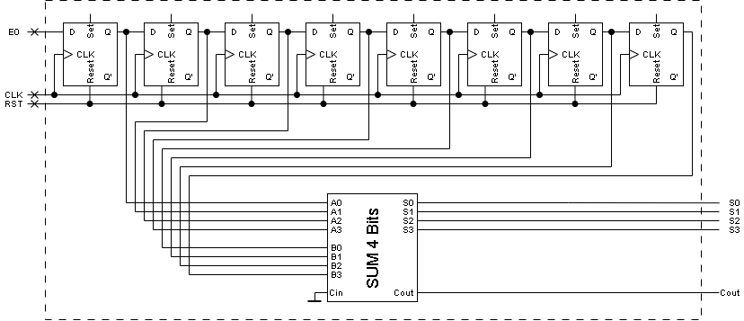

# Sumador serial de 8 bits

**Fecha:** 15-10-2026

## Consigna

Utilizando flip-flops tipo D y un sumador de 4 bits, construir un sumador serial de 8 bits, que suma los cuatro bits menos significativos de la entrada a los cuatro bits más significativos de la entrada.
La ventana de 8 bits se desplaza un bit en cada ciclo, de modo que la operación se realiza siempre sobre los 8 bits más recientemente recibidos. El resultado está formado por cuatro bits en paralelo. El sumador debe tener línea de reset que activa en 1.

## Resolución

Antes de empezar con la resolución, conviene detallar la siguente observación sobre la letra que está redactadas de forma extraña, lo que puede generar confusiones.

> construir un sumador serial de 8 bits

Esta parte se refiere a que el sumador que queremos construir tendrá 8 entradas, 4 para el primer número, y 4 para el segundo. Por lo tanto, la salida del circuito a construir estará compuesta por el resultado en 4 bits.

Ahora si, estamos en condiciones de determinar como resolver este ejercicio. La pista principal es el siguiente fragmento de la letra:

> La ventana de 8 bits se desplaza un bit en cada ciclo, de modo que la operación se realiza siempre sobre los 8 bits más recientemente recibidos.

Esto implica que necesitaremos memoria para almacenar los bits de la última operación.

A continuación se muestra el circuito:

El único detalle que puede no ser correcto según como interpreté la letra, es que el bit ingresado cada vez, es el menos significativo de los 8; por lo que el desplazamiento deseado ocurre de derecha a izquierda.

Esto concluye el ejercicio.