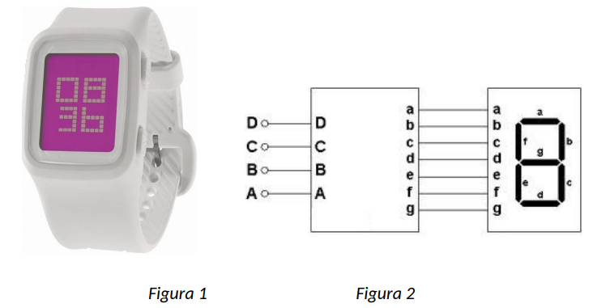
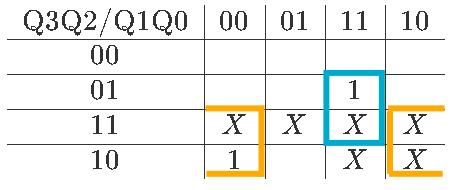
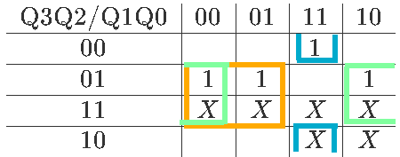
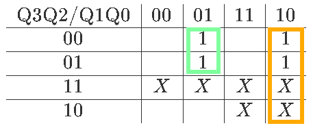
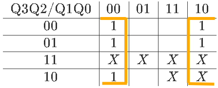
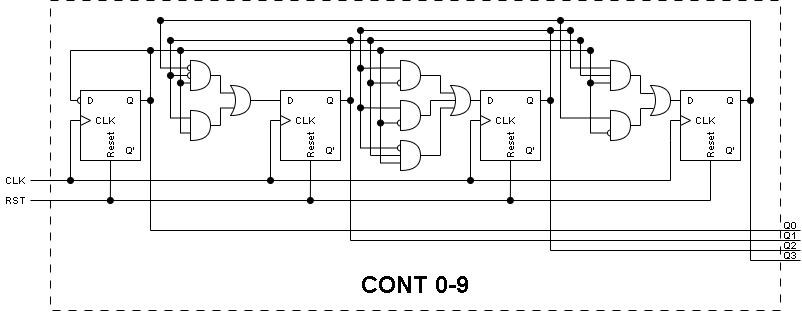
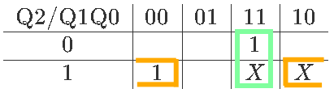
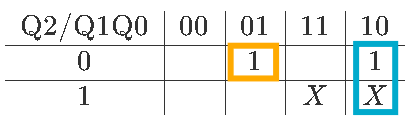
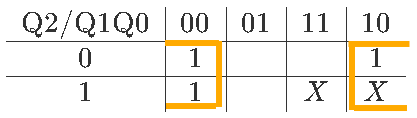
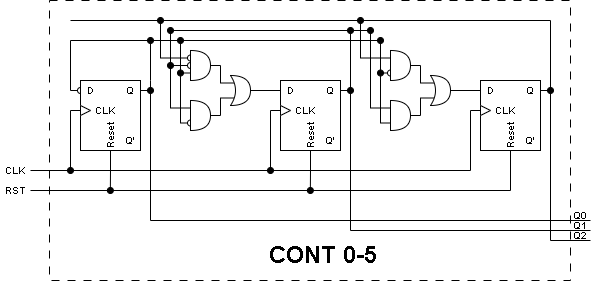

# Construir un cronómetro: calidad éxamen

**Fecha:** 16-10-2026

## Consigna

Se desea construir un circuito cronómetro que cuenta minutos y segundos. El mismo debe mostrar en todo momento el tiempo en un display de cuatro dígitos de 7 segmentos (dos para los minutos, dos para los segundos), es decir de (**00:00 a 59:59**).
El cronómetro tiene un botón de reset pone el sistema en **00:00**. En todo momento que el boton reset no este presionado, el cronometro debe actualizarse una vez por segundo.
Una imagen del cronómetro se puede ver en la figura 1 y un detalle de las entradas de cada módulo de display de 7 segmentos en la figura 2:

Para construir el sistema se cuenta con una señal de reloj de 1Hz.

1. Implementar un contador del 0-9 y un contador de 0-6 con el reset que considere correspondiente, utilizando flip-flops tipo D.
2. Resolver el circuito planteado a partir de los contadores diseñados en la parte a, módulos display 7 segmentos (1 dígito cada módulo) y compuertas básicas.
3. Modifique el circuito anterior agregando la siguiente funcionalidad: el circuito ahora cuenta con dos botones:
    - El botón reset previamente descripto
    - Un botón incrementar que incrementa el tiempo a razón de 1 minuto por cada segundo que el botón esté presionado. Mientras que se está pulsando este botón los segundos no deben incrementarse
    Mientras el botón incrementar no esté presionado, el circuito debe funcionar normalmente.

## Resolución

Este ejercicio es una consolidación de todos los conceptos que aprendimos a lo largo de este práctico.

### Parte 1

- Implementar un contador del 0-9 y un contador de 0-6 con el reset que considere correspondiente, utilizando flip-flops tipo D.

Para esta parte usaremos la estrategia vista en el teórico para construir contadores con flip-flops tipo D. Construiremos primero el contador de 0-9 que es el más complejo (requiere 1 bit más), el contador de 0-6 se construye análogamente de forma más simple.

#### Contador 0-9

El primer paso es crear una tabla con los "nuevos" valores a partir de los "actuales".

$$
\begin{array}{ccc}
&\text{Actuales}&\text{Nuevos}\\
&\text{Q3 Q2 Q1 Q0}&\text{D3 D2 D1 D0}\\
0&0\quad0\quad0\quad0&0\quad0\quad0\quad1\\
1&0\quad0\quad0\quad1&0\quad0\quad1\quad0\\
2&0\quad0\quad1\quad0&0\quad0\quad1\quad1\\
3&0\quad0\quad1\quad1&0\quad1\quad0\quad0\\
4&0\quad1\quad0\quad0&0\quad1\quad0\quad1\\
5&0\quad1\quad0\quad1&0\quad1\quad1\quad0\\
6&0\quad1\quad1\quad0&0\quad1\quad1\quad1\\
7&0\quad1\quad1\quad1&1\quad0\quad0\quad0\\
8&1\quad0\quad0\quad0&1\quad0\quad0\quad1\\
9&1\quad0\quad0\quad1&0\quad0\quad0\quad0\\
\end{array}
$$

A continuación hacemos el mapa de Karnaugh para cada uno de los bits nuevos, utilizando comodines para los valores que no nos interesan (10-15):

**D3**:

Y por lo tanto $D3=Q3Q0'+Q2Q1Q0$

**D2**:

Y por lo tanto $D2=Q2Q1'+Q2'Q1Q0+Q2Q0'$

**D1**:

Y por lo tanto $D1=Q3'Q1'Q0+Q1Q0$

**D0**:

Y por lo tanto $D0=Q0'$

Resumimos todo en las siguientes expresiones:

- $D3=Q3Q0'+Q2Q1Q0$
- $D2=Q2Q1'+Q2'Q1Q0+Q2Q0'$
- $D1=Q3'Q1'Q0+Q1Q0$
- $D0=Q0'$

Esto nos permite construir el circuito que es el siguiente:

#### Contador 0-6 (0-5 en realidad)

Como anticipa el título, mientras la letra solicita un contador 0-6, esto no es necesario para cumplir con los requerimientos. Por lo tanto se implementará un contador 0-5; pues el cronómetro va desde **00:00** hasta **59:59**.

En este caso, el primer paso ya está hecho pues usamos la misma tabla hasta el 5:

$$
\begin{array}{ccc}
&\text{Actuales}&\text{Nuevos}\\
&\text{Q2 Q1 Q0}&\text{D2 D1 D0}\\
0&0\quad0\quad0&0\quad0\quad1\\
1&0\quad0\quad1&0\quad1\quad0\\
2&0\quad1\quad0&0\quad1\quad1\\
3&0\quad1\quad1&1\quad0\quad0\\
4&1\quad0\quad0&1\quad0\quad1\\
5&1\quad0\quad1&0\quad0\quad0\\
\end{array}
$$

A continuación hacemos el mapa de Karnaugh para cada uno de los bits nuevos, utilizando comodines para los valores que no nos interesan (6, 7):

**D2**:

Y por lo tanto $D2=Q2Q0'+Q1Q0$

**D1**:

Y por lo tanto $D1=Q2'Q1'Q0+Q1Q0'$

**D0**:

Y por lo tanto $D0=Q0'$

$$
\begin{array}{c|c|c|c|c}
\text{Q2}/\text{Q1Q0}&00&01&11&10\\
\hline
0&1&&&1\\
\hline
1&1&&X&X\\
\end{array}
$$

Resumimos todo en las siguientes expresiones:

- $D2=Q2Q0'+Q1Q0$
- $D1=Q2'Q1'Q0+Q1Q0'$
- $D0=Q0'$

Esto nos permite construir el circuito que es el siguiente:

---

**Aclaración:** Si bien uno intenta no equivocarse en ninguna de estas tareas... Es bastante sencillo hacerlo; un 1 en un lugar incorrecto resulta en un circuito totalmente distinto que no cumple la función que queremos que cumpla. Tener esto en cuenta para no tomar el circuito como válido automáticamente