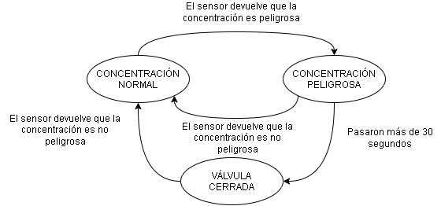

# Control de escape de gas

**Fecha:** 20-11-2026

## Consigna

Se desea controlar el escape de gas en una fábrica de recarga de garrafas. Por este motivo, se instala un sistema de seguridad controlado por un procesador utilizado en forma dedicada. El sistema está formado por un sensor de gas, un extractor y una válvula de corte.

El sensor controla la concentración de gas en el ambiente. Es posible conocer si la concentración de gas es peligrosa o no consultando el registro de E/S del sensor.

El extractor y la válvula pueden controlarse manipulando el registro de lectura/escritura asociado a ellos. Una vez cerrada, la válvula solo podrá abrirse manualmente.

El sistema debe encender el extractor toda vez que se detecte escape de gas (la concentración de gas es peligrosa) y apagarlo cuando el escape culmina. Si el escape persiste por más de 30 segundos, se debe cerrar la válvula y apagar el extractor cuando el escape haya finalizado.

El sensor está ubicado en la dirección de E/S `SENSOR`. El bit 0 tiene el valor $1$ si la concentración de gas es peligrosa y el valor $0$ cuando no lo es. Los bits del 1 al 7 son reservados.

El extractor y la válvula se controlan mediante la dirección de E/S `ACCESORIO`. El bit 0 se establece en $1$ para encender el extractor y en $0$ para apagarlo. El bit 1 se establece en $0$ para cerrar la válvula. Los bits del 2 al 7 son reservados.

Escribir todas las rutinas necesarias para implementar el sistema de seguridad en un lenguaje de alto nivel. Se dispone de un reloj externo que genera una interrupción cada $10\text{ Hz}$ que es atendida por la rutina `tiempo()`.

## Resolución

Para este ejercicio trabajamos con una máquina de estados como guía para implementar el código.



Una máquina bien hecha es, en general, la parte más complicada del problema resuelto. Conviene por lo menos empezar con este mapa para ejercicios más complejos e ir completando a medida que se lee la letra.

Usaremos una filosofía de programación diferente a las anteriores: incluiremos todo el código en la rutina principal, no en las interrupciones

```c
#define TREINTA_SEG 300
#define ESTADO_NORMAL 0
#define ESTADO_PELIGROSO 1
#define VALVULA_CERRADA 2

static volatile int ticks = 0;
void main() {
  static char estado = ESTADO_NORMAL;
  out(ACCESORIO, in(ACCESORIO) & ~0x01); // apagar extractor

  enable();
  while (true) {
    char sensor = in(SENSOR);
    switch(estado) {
      case ESTADO_NORMAL:
        if (sensor & 0x01) {
          out(ACCESORIO, in(ACCESORIO) | 0x01); // prender extractor
          estado = ESTADO_PELIGROSO;
          ticks = 0;
        }
        break;
      case ESTADO_PELIGROSO:
        if (sensor & 0x01 && ticks > TREINTA_SEG) {
          estado = VALVULA_CERRADA;
          out(ACCESORIO, in(ACCESORIO) & ~0x02); // cerrar válvula
        } else if (!(sensor & 0x01)) { // si ya no estamos en estado peligroso
          estado = ESTADO_NORMAL;
          out(ACCESORIO, in(ACCESORIO) & ~0x01); // apagar extractor
        }
        break;
      case VALVULA_CERRADA:
        if (!(sensor & 0x01)) {
          estado = ESTADO_NORMAL;
          out(ACCESORIO, in(ACCESORIO) & ~0x01); // apagar extractor
        }
        break;
    }
  }
}

// corre 10 veces por segundo: 1 tick -> 1 vuelta
void interrupt tiempo() {
  ticks++;
}
```