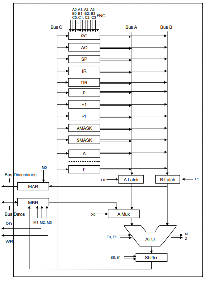

# Organización de la CPU

**Fecha:** 21-10-2026

## Componentes básicos de la CPU

En esta clase y la siguiente, veremos un posible diseño interno de una unidad central de proceso de una arquitectura de Von Neumann, incluyendo sus variaciones de "lógica cableada" y "lógica microprogramada".
Presentaremos como ejemplo la organización del procesador de la arquitectura MIC-1, desarrollada por Andrew S. Tanenbaum con fines didáticos en su libro *Structured Computer Organization*.

---

Como ya vimos, una CPU está conformada por tres sub-sistemas fundamentales: la ALU, la unidad de control y el banco de registros.

El **banco de registros** contiene registros de tres categorías desde el punto de vista de su función en relación con los programas y el funcionamiento interno de la CPU:
- *Totalmente visibles:* Estos son los que ya mencionamos en la clase anterior. El programador de "bajo nivel" los manipula directamente en los programas.
- *Parcialmente visibles:* Son registros que tienen funciones especiales, pero participan de algún modo indirecto en las instrucciones. El programador los manipula indirectamente en determinadas instrucciones específicas.
Ejemplos de este tipo de registros son el **IP** (Instruction Pointer), también denominado **PC** (Program Counter) que contiene la dirección de la próxima instrucción a ejecutarse (en alguna arquitectura almacena la que se está ejecutando en su lugar), el **SP** (Stack Pointer) que contiene el puntero al primer lugar de la pila en las arquitecturas de "Stack" y el **PS** (Processor Stack) también denominado registro de **FLAGS** (en el caso de Intel) que contiene el estado del procesador incluyendo el valor que tomaron los bits de condición (**N**egative, **Z**ero, **C**arry, **O**verflow) en función del resultado de la última operación realizada por la ALU.
- *Internos:* son registros que utiliza la unidad de control de la CPU para poder ejecutar las instrucciones. Almacenan constantes, el estado de la CPU, la instrucción en ejecución, resultados intermedios de cálculos de direcciones, etc. No son visibles de ninguna manera al programador.

La **unidad de control** es, en definitiva; una máquina secuencial que realiza el "ciclo de instrucción": conjunto de acciones ordenado y secuencial que interconectan adecuadamente los distintos elementos en el tiempo, para lograr el objetivo de ejecutar la instrucción realizando la operación indicada sobre los operandos correctos y almacenando el resultado en el lugar indicado. 
Esta máquina secuencial funciona sincronizada por un reloj, el cual también es usado para sincronizar todas las actividades de los otros elementos del sistema (memoria y entrada/salida).
En las primeras computadoras el reloj era el mismo para todos los elementos; últimamente se utilizan relojes independientes (aunque vínculados) para cada sub-sistema. En muchos diseños se utilizan más de un reloj para la CPU, con la misma frecuencia, pero desfasados, a los efectos de ser utilizados para sincronizar distintas partes del circuito compensando los diferentes retardos de propagación de las señales en los circuitos internos de la CPU.

La **unidad aritmética y lógica** es un conjunto de circuitos, típicamente combinatorios, que implementan un conjunto de operaciones, que incluyen suma y resta (en aritmética complemento a 2), operaciones lógicas bit a bit (AND, OR, XOR, NOT) y operaciones de desplazamiento (shift). Las ALU más avanzadas incluyen operaciones de multiplicación y división (aunque en este caso se implementan como una máquina secuencial que implementa algún algorítmo para estas operaciones)

### Ciclo de instrucción

Se denomina ciclo de instrucción a la secuencia de acciones que realiza la CPU (específicamente la unidad de control) para lograr ejecutar una instrucción del programa almacenado en memoria.
Un ciclo de instrucción típico tiene 5 pasos característicos:

- **Fetch:** este paso consiste en leer la próxima instrucción a ejecutarse desde la memoria.
- **Decode:** en este paso se analiza el código binario de la instrucción para determinar que se debe realizar (que operación, con que operandos y donde guardar el resultado).
- **Read:** en este paso se accede a memoria para traer los operandos.
- **Execute:** es la ejecución de la operación por parte de la ALU sobre los operandos.
- **Write:** en el último paso se escribe el resultado en el destino indicado en la instrucción.

**Nota:** No todas las instrucciones requieren de todos los pasos indicados para su ejecución. Por ejemplo las instrucciones que tienen sus operandos en registros, no requieren del paso "read"; mientras que las que no guardan un resultado, no requieren del paso "write".

Para realizar estos pasos la unidad de control maneja un conjunto de señales de control interno a la CPU y otras de control externo (en la interfaz con la memoria y con el sistema de entrada/salida), las que habilitan las conexiones apropiadas entre los distintos elementos de forma que el respectivo paso del ciclo se cumpla.
Por ejemplo: para hacer el "fetch" conecta el bus de direcciones de memoria con el registro PC (que contiene la dirección de la próxima instrucción a ejecutarse), conecta el bus de datos de memoria con el registro interno IR y coloca en el bus de control de la memoria las señales apropiadas para realizar una lectura.

En la propuesta de organización interna se dispone de los siguientes recursos (es una arquitectura de 16 bits):

- Registro **PC**: contiene el puntero de instrucción ("Program Counter")
- Registro **AC**: es el registro acumulador
- Registro **SP**: contiene el puntero a la pila ("Stack Pointer")
- Registro **IR**: almacena la instrucción leída en memoria
- Registro **TIR**: almacena temporalmente copias de la instrucción
- Registro **0**: contiene la constante 0
- Registro **+1**: contiene la constante +1
- Registro **-1**: contiene la constante -1 (complemento a 2)
- Registros **AMASK**: contiene el valor binario 0000111111111111 -> 0x0fff
- Registros **SMASK**: contiene el valor binario 0000000011111111 -> 0x00ff
- Registros **A** a **F**: para uso interno de la unidad de control.
- Registro **MAR** (memory address register): almacena la dirección de memoria que se presenta en el bus de direcciones de la memoria durante una operación de lectura o escritura de la misma.
- Registro **MBR** (memory buffer register): almacena el dato leído de la memoria (en una operación de lectura) o el dato a escribir en memoria (en una operación de escritura).
- **AMux**: multiplexor que elige entre dos entradas posibles.
- **ALU**: unidad aritmética y lógica, capaz de ejecutar 4 operaciones: suma A+B, A and B, identidad A (la salida es A), not A.
- **Shifter**: unidad encargada de realizar la operación de desplazamiento: 0 bit (no hace nada), 1 bit a la derecha, 1 bit a la izquierad.
- **ALatch/BLatch**: son registros intermedios que retienen los valores de A y B respectivamente, utilizados para simplificar los aspectos de sincronismo de las señales, requeridos porque el diseño original de Tanenbaum prevé la construcción del banco de registros con flip-flops asíncronos (un diseño basado en FF con reloj por flanco podría evitar el uso de estos registros intermedios).

Notas:

- La interfaz con la memoria y la E/S se realiza a través del bus de datos, el bus de direcciones y el bus de control (conformado por las señales RD y WR).
- Los registros, la ALU y la unidad de Shift son de 16 bits de tamaño de palabra.
- La unidad de Shift no siempre se explicita como en el ejemplo ya que se puede considerar que forma parte de la ALU.
- Normalmente la ALUs calculan también las salidas C (Carry) y V (oVerflow).
- Los valores de las constantes de los distintos registros está vínculada con las necesidades de la "macroarquitectura" asociada a la MIC-1 y no constituyen un requisito en otras microarquitecturas (la microarquitectura asociada a la MIC-1 se llamará MAC-1 de acá en adelante).
- Tener presente que este es tan solo un ejemplo de como se puede construir internamente una CPU, y ni siquiera es uno que pueda considerarse óptimo.

Por razones de simplicidad se ha omitido dibujar la unidad de control en el diagrama anterior. Esta es una máquina secuencial; las salidas de este circuito son todas las señales de control indicadas en el diagrama, que actúan sobre los distintos recursos internos y el bus de control externo de manera de completar los distintos pasos del ciclo de instrucción visto.

Las funciones que cumplirían las distintas señales de control son:

- **A3, A2, A1, A0:** seleccionan un registro y conectan su salida al bus A. Por ejemplo: 0000/PC, 0001/AC, 0010/SP, 0011/IR, 0100/TIR, 0101/0, 0110/+1, 0111/-1, 1000/AMASK, 1001/SMASK, 1010/A, 1011/B, ..., 1111/F.
- **B3, B2, B1, B0:** seleccionan un registro y conectan su salida al bus B (con la misma codificación que A).
- **C3, C2, C1, C0:** seleccionan un registro y conectan su salida al bus C (con la misma codificación que A).
- **ENC:** habilita el bus C para que se guarde el valor en el registro seleccionado.
- **X0:** selecciona si conecta a su salida la entrada que viene desde el MBR o desde el bus A (0: MBR, 1: Bus A).
- **F1, F0:** codifican la operación a realizar por la ALU (00: A+B, 01: A and B, 10: A, 11: not A)
- **S1, S0:** codifican la operación de desplazamiento (00: no desplaza, 01: un bit a la derecha, 10: un bit a la izquierda)
- **L1, L0:** controlan la carga de los registros intermedios del bus B y del bus A respectivamente.
- **M0:** controla la carga en el MAR (1: carga)
- **M1, M2, M3:** controlan la forma en que se cargan los datos en el MBR, cuando y desde donde se produce. 
    - M1 activa la carga (1: carga).
    - M2 es la señal que lectura de memoria RD (1: lee la memoria)
    - M3 es la señal de escritura de memoria (1: escribe la memoria)

Veamos como manejaría la unidad de control estas **señales de control** para lograr ejecutar el ciclo de instrucción. Consideremos el ejemplo en el que se va a ejecutar una suma entre un operando en memoria y el acumulador, con modo de direccionamiento directo (la dirección está en los últimos 12 bits de la instrucción).

#### 1. Fetch

El primer paso es el *fetch*. Para leer la instrucción en memoria se debe cargar el contenido del registro PC en el MAR, realizar una operación de lectura desde memoria y se debe conectar el bus de datos con el registro IR, de forma de cargar en él la instrucción.
Para ello hay que:

- conectar la salida del registro PC al bus B (B3=0, B2=0, B1=0, B0=0)
- seleccionar cargar el BLatch (L0=1)
- seleccionar cargar MAR (M0=1)
- selccionar cargar el MBR (M1=1)
- seleccionar lectura de memoria (M2=1)
- seleccionar MBR en el AMux (X0=0)
- seleccionar la operación "identidad A" en la ALU (F1=1, F0=0)
- seleccionar no desplazamiento en el Shifter (S1=0, S0=0)
- conectar la entrada del registro IR al bus C (C3=0, C2=0, C1=1, C0=1)
- habilitar el bus C (ENC=1)

Al colocar todas estas señales en los valores indicados se procederá a la lectura de la instrucción contenida en la dirección indicada por PC en la memoria.

**Nota:** Notemos que de acuerdo a los tiempos de acceso de la memoria se pueden llegar a necesitar mantener las señales por más de un ciclo de reloj a los efectos de tener en cuenta las latencias (tiempos de propagación) de la circuitería involucrada.

Para completar el paso de *fetch* es necesario actualizar el valor de PC, para lo que se requieren las siguientes señales (en el siguiente ciclo de reloj):

- conectar la salida del registro PC al bus B (B3=0, B2=0, B1=0, B0=0)
- conectar la salida del registro +1 al bus A (A3=0, A2=1, A1=1, A0=0)
- seleccionar cargar el ALatch (L1=1)
- seleccionar cargar el BLatch (L0=1)
- seleccionar bus A en el AMux (X0=1)
- seleccionar A+B en la ALU (F1=0, F0=0)
- seleccionar no desplazamiento en el Shifter (S1=0, S0=0)
- conectar la entrada del registro PC al bus C (C3=0, C2=0, C1=0, C0=0)
- habilitar bus C (ENC=1)

#### 2. Decode

El siguiente paso del ciclo es el *decode*. La decodificación se realiza analizando el código binario de la instrucción. 
Para ello se implementa en la CPU una función mediante un circuito combinatorio que toma como entrada el contenido de la IR y da como salida los valores apropiados de las señales de control, condicionando también el próximo estado de la máquina secuencial, como en el caso del ejemplo ya que al reconocer el modo de direccionamiento directo debe realizarse el paso de *read*.

#### 3. Read

Para realizar el paso de *read* se debe cargar la dirección del operando (contenida en los últimos 12 bits de la instrucción) en el MAR, para luego realizar una operación de lectura desde memoria, cargando el MBR desde el bus de datos, de forma de almacenar en él el operando. Para ello hay que:

- conectar la salida del registro IR al bus B (B3=0, B2=0, B1=1, B0=1)
- conectar la salida del registro AMASK al bus A (A3=1, A2=0, A1=0, A0=0)
- seleccionar cargar el ALatch (L1=1)
- seleccionar cargar el BLatch (L0=1)
- seleccionar bus A en el AMux (X0=1)
- seleccionar A and B en la ALU (F1=0, F0=1)
- seleccionar no desplazamiento en el Shifter (S1=0, S0=0)
- conectar la entrada del registro A al bus C (C3=1, C2=0, C1=0, C0=0)
- habilitar bus C (ENC=1)

Con estas señales y sincronizado por el reloj se guarda la dirección contenida en la instrucción del registro A. En el próximo ciclo de reloj se colocan las siguientes señales:

- conectar la salida del registro A al bus B (B3=1, B2=0, B1=1, B0=0)
- seleccionar cargar al BLatch (L0=1)
- seleccionar cargar MAR (M0=1)
- seleccionar cargar el MBR (M1=1)
- seleccionar lectura de memoria (M2=1)

#### 4. Execute

En el siguiente paso se realiza el *execute*. Para ello se deben activar las siguientes señales:

- conectar la salida del registro *AC* al bus B (B3=0, B2=0, B1=0, B0=1)
- seleccionar cargar el BLatch (L0=1)
- seleccionar MBR en el AMux (X0=0)
- seleccionar la operación A+B en la ALU (F1=0, F0=0)
- seleccionar no desplazamiento en el Shifter (S1=0, S0=0)
- conectar la entrada del registro AC al bus C (C3=1, C2=0, C1=1, C0=1)
- habilitar bus C (ENC=1)

Sincronizado por el reloj, se realiza una operación en la ALU y se guarda el resultado en el registro AC.

---

Cabe destacar que al ser una instrucción cuyo resultado se almacena en un registro, no corresponde que exista un paso de *write*.