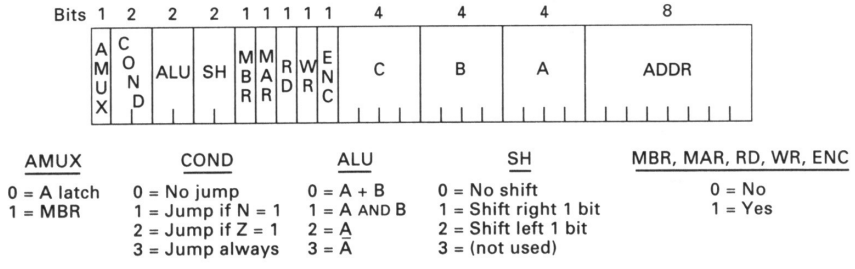
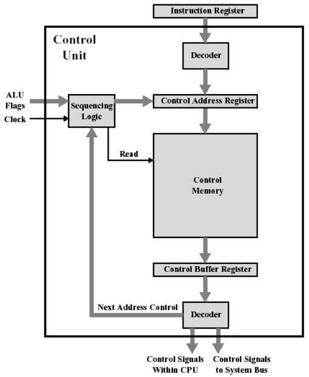
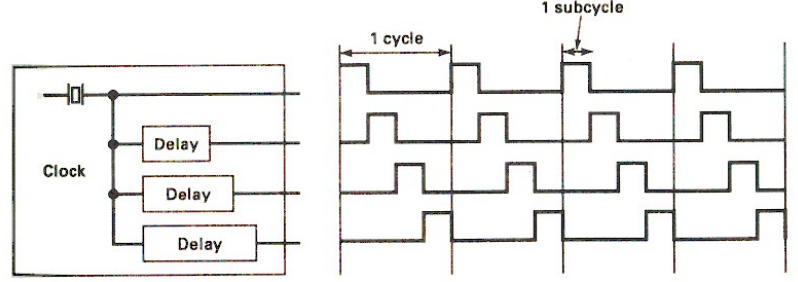
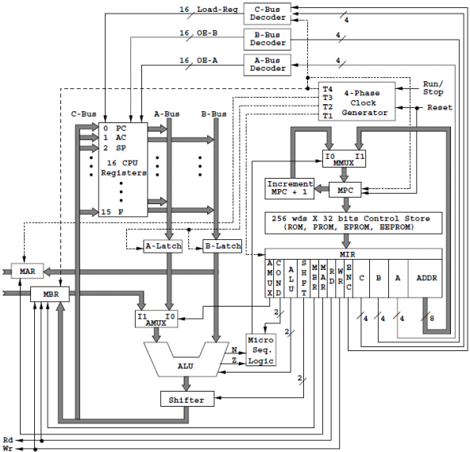
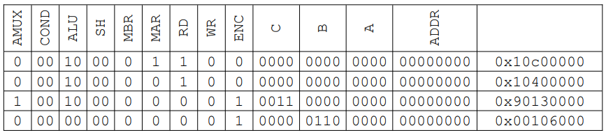
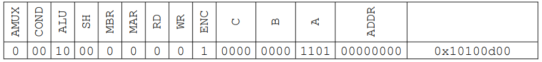

# Organización de la CPU

**Fecha:** 23-10-2026

## Lógica cableada vs lógica microprogramada

Hay dos filosofías de diseño claramente diferenciadas para la unidad de control: la "lógica cableada" y la "lógica microprogramada".

El diseño de la unidad de control en base a la filosofía de "lógica cableada" se hace como cualquier circuito secuencial: en base a un diagrama de estados traduciéndola a una máquina de Mealy (por ejemplo). Para el ejemplo anterior deberíamos tomar como salidas todas las señales de control y como entradas los bits del código binario de las instrucciones.
En este caso el resultado es óptimo desde el punto de vista de la velocidad de los circuitos, pero tiene poca flexibilidad ya que cualquier otro cambio en el diseño del set de instrucciones de la CPU genera la necesidad de reescribir el diagrama de estados y por lo tanto, de cambiar todo el circuito lógico que lo implementa.

---

Por otra parte, la "lógica microprogramada" propone que la unidad de control se construya en base a un autómata más sencillo que "ejecute" el ciclo de instrucción para cada instrucción de la CPU, siguiendo en secuencia un conjunto de "microinstrucciones" que contienen los valores de las señales apropiados para esta instrucción particular.
Es decir que para cada instrucción a nivel de la CPU existirá un "microprograma", consistente en una secuencia lógica de microinstrucciones que establecerán el órden de los eventos necesarios para lograr la ejecución de la instrucción en la CPU, incluyendo todas las "bifurcaciones" de la secuencia que se requieran en base a los distintos tipos de direccionamiento y cualquier otra variante que admita la instrucción específica.

En este caso hay una penalización en la velocidad de proceso porque el microprograma se almacena en una ROM interna de la CPU, y cada microinstrucción debe ser leída de ella. Lo positivo es que simplifica enormemente la tarea de modificar el set de instrucciones, ya que simplemente alcanza con cambiar el contenido de la ROM del microprograma. También las máquinas microprogramadas permiten fácilmente implementar instrucciones complejas, tales cómo la búsqueda de un elemento en un array o la copia/comparación de arrays, etc.

---

La tendencia en diseño de CPU era, hasta la década de 1980, utilizar lógica microprogramada. La aparición de las arquitecturas RISC puso en cuestión tendencia, ya que dichas propuestas promovían el uso de lógica cableada, en particular asociado al concepto de optimizar la velocidad de proceso.
De todos modos es probable que la ventaja que esos diseños se deba principalmente al uso óptimo de técnicas como el "pipelining" (se verá más adelante) permitido por las características de su set de instrucciones. El punto es que si se usa un set "reducido" con fines de optimización, también resulta más sencillo implementar la CPU en "lógica cableada"

## Microprogramación horizontal y vertical

Si quisiéramos implementar en microcódigo la unidad de control del ejemplo de la clase pasada, tendríamos que cada microinstrucción debería contener la codificación en bits de las señales de control de los distintos caminos de las señales de datos, como ocurre con el acceso al banco de registros. Este es uno de los enfoques posibles y de hecho tiene la ventaja de reducir la cantidad de bits necesarios para codificar cada microinstrucción; recibe el nombre de **microprogramación vertical**.
Este tipo de microprogramación supone que determinados conjuntos de recursos solo pueden ser utilizados de a uno por vez en cada función (por eso se pueden codificar). Esto permite ahorrar bits (por lo tanto espacio en la ROM de microprograma), pero queda firme esa restricción que puede ser perjudicial a la hora de generar altos niveles de paralelismo, en especial en arquitecturas más complejas que la del ejemplo.

Por el contrario la **microprogramación horizontal** utiliza microinstrucciones con los bits de control sin codificar. Para el caso del ejemplo se requerirían 16 bits de control para cada bus (1 bit para cada uno de los registros) en vez de los 4 utilizados de forma codificada.

## Microinstrucciones

La microarquitectura MIC-1 que hemos tomado como ejemplo propone una implementación mediante microprogramación. Para ello cuenta con una ROM para microprogramas (denominada "Control Store"), interna a la CPU, que permite almacenar un total de 256 microinstrucciones. Cada microinstrucción es codificada con un código binario de 32 bits.

Cada microinstrucción deberá tener bits disponibles para indicar los valores de las señales que controlan los distintos elementos. A continuación se especifican los bits:

- 4 bits para control de bus A
- 4 bits para control de bus B
- 4 bits para control de bus C
- 1 bit para habilitación de bus C
- 2 bits para control de latches de bus
- 2 bits para control de la ALU
- 2 bits para control del Shifter
- 1 bit para control del AMux
- 1 bit para control del MAR
- 3 bit para control del MBR

El control de los latches en realidad es necesario en prácticamente todos los casos, por lo que se lo realizará directamente mediante el reloj, con lo que se requieren 22 señales.
Dado que se utilizan 32 bits para codificar las microinstrucciones, los restantes 10 bits se utilizan para manejar la secuenciación del microprograma, como se explicará a continuación. Antes veamos el formato de las microinstrucciones:



Para secuenciar las microinstrucciones del microprograma, se procede de la siguiente manera en función de lo que esté codificado en COND:

- 00: la ubicada a continuación en la memoria ROM de microprograma
- 01: si la salida N de la ALU es 1 la ubicada en la dirección de la ROM ADDR
- 10: si la salida Z de la ALU es 1 la ubicada en la dirección de la ROM ADDR
- 11: siempre la ubicada en la dirección de la ROM ADDR

## Unidad de control microprogramada

En general una implementación de una unidad de control microprogramada dispone de:

- una ROM para almacenar las microinstrucciones de los microprograman que implementan el ciclo de instrucción de las instrucciones de la CPU
- una máqina secuencial que ejecuta la secuenciación de las microinstrucciones de acuerdo a la lógica que se haya codificado

El esquema es:



La implementación de MIC-1 utiliza para su sincronismo interno la técnica de relojes desfasados, que son señales de reloj obtenidas de un reloj "padre" mediante la utilización de "líneas de retardo" (dispositivos electrónicos que provocan un cierto retraso en la propagación de la señal):



Incorporando la parte de sincronismo y los elementos de la unidad de control microprogramada al esquema de la MIC-1, ésta queda:



Los elementos de la unidad de control microprogramada de la MIC-1 son:

- **MPC (Micro Program Counter):** es un registro que almacena la dirección (8 bits) de la microinstrucción que se va a ejecutar
- **Increment:** circuito combinatorio que suma uno.
- **Mmux:** es un multiplexor que selecciona entre la salida del Increment y los últimos 8 bits del MIR para determinar la dirección de la ROM.
- **Control store:** memoria ROM de 256 palabras de 32 bits donde se almacenan las microinstrucciones.
- **MIR (Micro Instruction Register):** registro que almacena la microinstrucción leída desde el Control Store

## Micro ensamblador

Un microprograma será una colección de códigos binarios que representen a las microinstrucciones necesarias para controlar las señales deseadas. Por ejemplo:



Al igual que para el caso de las instrucciones, "programar" en códigos binarios es bastante engorroso. Por esto se desarrollan lenguajes "ensambladores" que permiten utilizar una nomenclatura bastante más amigable para representar las microinstrucciones.

Para este ejemplo veremos el MAL (Micro Assembler Language) propuesto por Tanenbaum para su MIC-1.

Este micro-ensamblador tiene una notación basada en identfificar en cada "sentencia" a todas las señales que deben estar en 1 (no aparecen las que van en 0). Para señalar las asignaciones de los buses A, B y C usa la notación como muestra el siguiente ejemplo:

- ac:=d

Éste indica que se debe copiar el contenido del registro D en el registro AC, para lo cual el bus C se conecta al registro AC, se activa ENC, el registro D se conecta al bus A, la ALU realiza la operación identidad y el Shifter no desplaza.
La codificación de esta microinstrucción sería:



Las cuatro operaciones de la ALU se representan así (los registros usados son a modo de ejemplo):

- ac:= ac+d
- ac:= band(ir, smask)
- f:= ac
- c:= inv(a)

Los registros destino pueden ser cualquiera (incluyendo el MBR y el MAR), pero el MAR no puede ser operando.

Las dos operaciones efectivas de la unidad de desplazamiento se representan así:

- lshift(ac)
- rshift(ir)

Las operaciones de desplazamiento también aceptan como argumento una operación de la ALU:

- lshift(tir+tir)

(En este último caso la microinstrucción hace un shift de dos bits a la izquierda)
Las activación de las señales RD (read) y WR (write) se realiza colocando rd o wr en la expresión.

La secuenciación de las microinstrucciones se realiza mediante la expresión:

- if n then goto XXXX
- if z then goto XXXX

Donde XXXX es la dirección de 8 bits de la memoria ROM donde se almacena la microinstrucción a la que se quiere ir.

Las distintas expresiones pueden combinarse en una misma microinstrucción:

- tir:= lshift(tir+tir); if n then goto 33

El efecto de esta microinstrucción es guardar en TIR el resultado de realizar un desplazamiento a la izquierda de 2 bits del propio registro TIR y saltar a la microinstrucción 33 si es que el segundo bit más significativo del valor de TIR es 1 (notar que la ALU hace solo la suma, que representa el desplazamiento a la izquierda de un bit y por lo tanto allí el bit más significativo del resultado, es el segundo bit más significativo del original).

Hay un caso particular de sentencias, donde solo nos interesa determinar un salto en alguna condición de los bits de un registro, pero no queremos asignarlo a ningún otro registro. Para ese caso se dispone del "registro virtual" llamado "alu" que se usa así:

- alu:=lshift(tir+tir); if n then goto 33

En este caso el resultado de la operación sobre TIR no afecta a ningún registro, pero la ALU actúa y computa el valor de la salida N según el resultado de la operación.

Por ejemplo: las codificaciones del primer ejemplo mostrado corresponden a las siguientes microinstrucciones:

```
mar:=pc; rd
rd
ir:= mbr
pc:=pc+1
```

Esta secuencia hace lo siguiente:
1. Carga el registro PC en el MAR y activa las señal RD de lectura.
2. Se mantiene RD activa (porque se asume que la lectura demora dos ciclos de reloj)
3. Mueve el contenido leído de MBR al registro IR
4. Suma 1 al registro PC

No es díficil identificar esta sucesión de eventos con la etapa del *fetch* del ciclo instrucción.