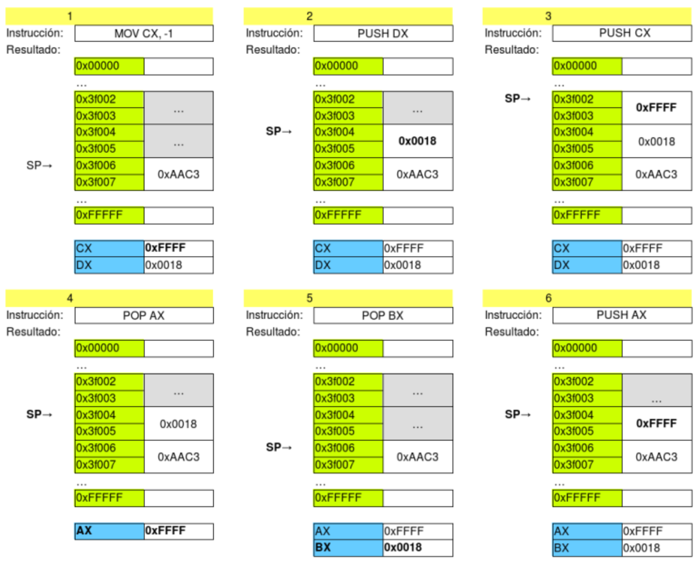
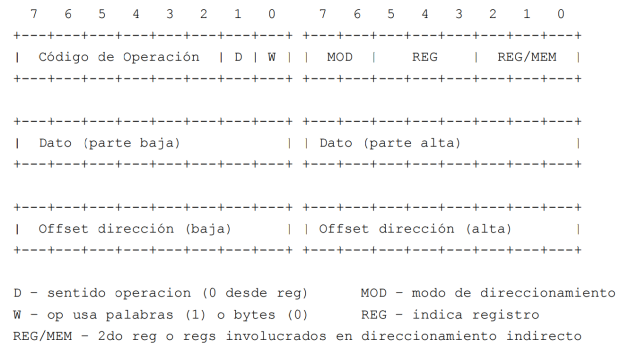
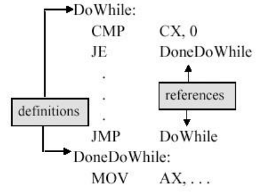

# Arquitectura Intel 8086

**Fecha:** 02-11-2026

## Introducción

En esta clase comenzaremos a desglosar la arquitectura Intel 8086: ésta cuenta con algunos puntos claves que la distinguen:

- Procesador de 16 bits
- Memoria *segmentada*
- 12 registros visibles (con personalidad, no genéricos)
- *Little Endian*
- Diseño CISC (incluyendo instrucciones de multiplicación y división entera)
- Stack por Hardware

Expandiremos cada uno de estos puntos para acercarnos mejor a la arquitectura y a entender bien su funcionamiento.

## Ancho de palabra

Es un procesador de 16 bits, es decir que su camino de datos tiene un tamaño de 16 bits. Esto incluye registros, ALU y buses internos. Cuando decimos palabra, nos estaremos refiriendo a 16 bits de tamaño. La memoria en un sistema x86 se direcciona de a byte.
**Nota:** $2^{16}=65536$

## Registros

La arquitectura Intel 8086 cuenta con 12 registros visibles para el programador: CS, DS, SS, ES, AX, BX, CX, DX, SI, DI, SP y BP.
Como mencionamos anteriormente, son registros visibles al programador pero **no son de uso genérico.**
Contamos también con algunos registros parcialmente visibles: FLAGS e IP.

A continuación explicamos mejor el propósito de los registros que vimos:

- **CS, DS, SS, ES:** Registros de segmento. Code, Data, Stack, Extra Segments
- **AX, BX, CX, DX:** Registros de uso general. Accumulator, Base, Counter y Data.
- **SP, BP:** Registros Stack y Base Pointer. Implementación stack.
- **SI, DI**: Registros Source y Destination Index.

### Registros de 8 bits

Los registros _X tienen una particularidad: podemos acceder independientemente a su parte alta o baja, entendiéndose parte alta como los 8 bits más significativos y parte baja como los 8 bits menos significativos.
Esto que mencionamos se hace a través de los registros High y Low; por ejemplo: CH se corresponde con la parte alta de CX.

```
mov CH, 1
mov CL, 0
; CX vale 0x0100
```

### Flags

Existe un registro parcialmente visible en donde se almacenan bits de resultado y configuración. A continuación se muestra una imagen de como están distribuidos los mismos en los 16 bits del registro correspondiente.


La CPU actualiza este registro de acuerdo al resultado de algunas de las instrucciones.
Como ya vimos en las clases anteriores, esto nos permite conocer las características de un resultado (¿es cero?) y del CPU (¿están habilitadas las instrucciones?).

Para implementar estructuras de control (if, while, for) utilizaremos saltos condicionales, en base a las flags.

## Segmentación

Como mencionamos en una sección anterior, esta arquitectura tiene un tamaño de 16 bits: esto limita bastante el acceso a la memoria ya que con direcciones de 16 bits solamente podemos direccionar 64 KB.

Para sobreponerse a esta limitación, la arquitectura implementa un sistema de segmentación que permite ampliar la capacidad de direccionamiento a 1MB mediante direcciones de 20 bits.

**Nota:** No por este hecho la arquitectura deja de ser de 16 bits.

En la sección de registro vimos que existen 4 registros de segmento (CS, DS, SS, ES) que se utilizan exclusivamente para el acceso a memoria.
Para acceder a memoria **siempre** utilizamos un registro de segmento, el cual se multiplica por $2^4$ y se sumará a la dirección indicada.

```
Dirección final [20] = Registro de segmento * 2^4 + Dirección indicada
```

Esto genera *segmentos* en la memoria; por ejemplo, si CS = 0x3100, su segmento abarca desde 0x31000 hasta 0x40FFF (0x31000 + 0xFFFF).

Esto es una construcción y no un elemento visible en los datos de la memoria. Puede existir solapamiento, incluso completo.

En la siguiente imagen vemos un ejemplo de como se puede dividir la memoria en partes, en donde todos los registros "de la izquierda" marcan los respectivos inicios de los segmentos.
Por otra parte los registros "de la derecha" marcan lo que sería el desplazamiento dentro de cada segmento.


A continuación, veremos todas las formas posibles para calcular un desplazamiento: éste se puede conseguir combinando distintos elementos en una sola expresión:

```
1. {BX | BP} [+ {SI | DI}] [+ desplazamiento] ; direccionamiento basado-indexado
2. {SI | DI} [+ desplazamiento] ; direccionamiento indexado puro
3. [desplazamiento] ; direccionamiento directo
```

### Endianess

Una palabra de memoria es un byte, pero una palabra del CPU son 2. ¿Cómo se dispone cuando se guarda en memoria?

- El *endianess* es un término que se refiere a como se almacena en memoria una palabra de una arquitectura mayor.
- *Little endian* indica que en la posición menor, va el byte menos significativo (esta es la utilizada por Intel 8086)
- *Big endian* indica que en la posición menor, va el byte más significativo

## Stack

La arquitectura Intel provee como herramienta para el programador un stack implementado por hardware sobre memoria. Este stack es un elemento fundamental de la arquitectura, principalmente en el pasaje de parámetros y la invocación a funciones.

El stack se encuentra implementado en hardware como una pila circular en el Stack Segment (SS) mediante dos punteros:

- **Stack Pointer:** es el puntero a la última posición ocupada del stack.
- **Base Pointer:** para direccionar en el stack.

Las posiciones del stack siempre ocupan 2 bytes, sin importar el tamaño del dato que se inserta.

La interacción con el stack es bastante sencilla y se hace mediante dos instrucciones: PUSH y POP.

- PUSH agrega datos al stack:

    ```
    PUSH AX ; Inserta el contenido del registro AX
            ; en el tope del stack.
    ```
- POP retira los datos hacia otra posición. El destino puede ser un registro u otra dirección de memoria
    ```
    POP CX ; Carga en CX el contenido del tope del stack
    POP ES:[BX] ; Carga en la posición de memoria ES*16+BX
                ; el contenido del tope del stack.
    ```

A continuación se muestra una rutina de ejemplo sobre como funcionan las instrucciones.



## Set de instrucciones

Intel 8086 es una arquitectura tipo CISC, con set de instrucciones amplio. Por ejemplo: CMPS, MUL.
Instrucciones con accesos a memoria implícitos, duración variable y de largo variable.
Provee instrucciones:

- Aritméticas (ADD, SUB, INC)
- Lógicas (AND, OR, XOR)
- Control (JMP, JZ)
- Transferencia de datos (MOV, IN, OUT, PUSH, POP)
- Configuración (STI, CLI)

Además las instrucciones tienen las siguientes características:

- Codificadas en largo variable (1 a 6 bytes)
- Aceptan (a lo sumo) 2 operandos
- Máximo 1 operando puede ser memoria
- Su formato nemotécnico es INSTR op1, op2

### Modos de direccionamiento

Los modos de direccionamiento utilizados utilizado son:

- Inmediato - mov AX, 2
- Directo a registro - mov AX, 2
- Directo a memoria - mov AX, ES:[0x200]
- Indirecto por registro - mov AX, ES:[BX]
- Indizado - mov AX, ES:[BX+SI]

### Codificación de instrucciones

La codificación de las instrucciones es como se muestra a continuación:



## Assembler 8086

En el curso veremos una versión básica de *Assembler 8086*. Un programa de este lenguaje se compone por: comentarios, constantes, instrucciones, etiquetas, directivas.
Con esto, el ensamblador generará el bitcode necesario.

### Comentarios

Todo lo que se encuentre luego de un caracter `;` se toma como un comentario.

```
ADD AX, BX ; Esto es un comentario
; Esto también es un comentario
```

### Constantes

Son utilizadas para indicar datos que no cambian y datos iniciales.

- Binarios, octales y hexadecimales (001101b, 664o, FE53h o 0xFE53)
- Enteros (23, -120)
- Strings ("c", "Hola, mundo!")

### Instrucciones

Las instrucciones se escribirán una atrás de la otra, el ensamblador las traducirá a bytes y concatenará en memoria de la misma forma. Cada instrucción tiene un largo variable, por lo que no es fácil saber cuanto ocupa un programa en memoria.
Tenemos disponible en el curso (parciales y exámenes) una cartilla que contiene cada instrucción, su descripción y más parámetros.

La cartilla mencionada contiene ejemplos y toda la información que necesitamos sobre cualquier instrucción de la arquitectura. Es fundamental agarrar práctica con ésta haciendo ejercicios.

### Etiquetas

Se utilizan para tener referencias accesibles a diferentes posiciones de memoria de datos o código.
Referencia la primera posición del dato o instrucción a continuación.
Pueden estar formadas por letras y números.



### Directivas

Las directivas se utilizan para indicar datos constantes y datos iniciales:

- EQU
- DB, DW, DDW, DUP
- PROC y ENDP

#### Directiva EQU

La directiva EQU se utiliza para definir constantes y atajos para programar:

```
max_posiciones EQU 8
tam_arreglo EQU max_posiciones * 4
```

#### Directiva DB, DW, DDW

Las directivas DB, DW y DDW se utilizan para declarar datos inicializados. Declare Byte, Declare Word, Declare Double Word respectivamente.

```
db 0x93 ; un byte con valor 0x93
db 0x94,0x95,0x96,0x97 ; cuatro bytes consecutivos
db ’q’ ; un byte con el valor ascii de q
dw 0x5A0 ; 0xA0 0x05
dw ’abc’ ; 4 bytes con 0x61 0x62 0x63 0x00
ddw 0x12345678 ; ocho bytes 0x78 0x56 0x34 0x12
```

#### Directiva DUP

La directiva DUP permite repetir declaraciones.

```
db 5 dup(0x93) ; 5 bytes con valor 0x93
dw 3 dup(0x5A0) ; 6 bytes 0xA0 0x05 0xA0 0x05 0xA0 0x05
```

#### Directivas PROC y ENDP

Marcan el principio y fin de procedimientos. Para definir un procedimiento:

```
nombreProc PROC
ADD AX, ...
...
nombreProc ENDP
```

## Estructuras de control

Para implementar algoritmos, precisamos controlar el flujo de nuestro programa. La siguiente instrucción a ejecutar por el CPU puede que no sea la que está a continuación.

Para esto contamos con las instrucción de salto en assembler. Mediante su combinación y estructurando el código adecuadamente, lograremos compilar estructuras de control de alto nivel.

### Instrucción CMP

La instrucción CMP es útil (aunque no indispensable) para compilar estructuras de control. Nos permite comparar dos operandos, sin necesidad de almacenar el resultado aunque si modificando las flags. Realiza una resta entre los operandos y descarta el resultado.

--- 

Esta sección es extensa en las notas, pero visto que ya hicimos ejercicios traduciendo estructuras de control en el práctico anterior no necesitamos estudiar en detalle como se replica el comportamiento de un if, if-else, while, etc. en assembler.