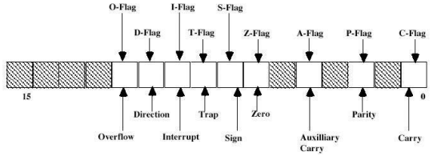
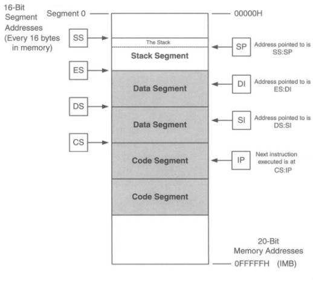

# Arquitectura Intel 8086

**Fecha:** 02-11-2026

## Introducción

En esta clase comenzaremos a desglosar la arquitectura Intel 8086: ésta cuenta con algunos puntos claves que la distinguen:

- Procesador de 16 bits
- Memoria *segmentada*
- 12 registros visibles (con personalidad, no genéricos)
- *Little Endian*
- Diseño CISC (incluyendo instrucciones de multiplicación y división entera)
- Stack por Hardware

Expandiremos cada uno de estos puntos para acercarnos mejor a la arquitectura y a entender bien su funcionamiento.

## Ancho de palabra

Es un procesador de 16 bits, es decir que su camino de datos tiene un tamaño de 16 bits. Esto incluye registros, ALU y buses internos. Cuando decimos palabra, nos estaremos refiriendo a 16 bits de tamaño. La memoria en un sistema x86 se direcciona de a byte.
**Nota:** $2^{16}=65536$

## Registros

La arquitectura Intel 8086 cuenta con 12 registros visibles para el programador: CS, DS, SS, ES, AX, BX, CX, DX, SI, DI, SP y BP.
Como mencionamos anteriormente, son registros visibles al programador pero **no son de uso genérico.**
Contamos también con algunos registros parcialmente visibles: FLAGS e IP.

A continuación explicamos mejor el propósito de los registros que vimos:

- **CS, DS, SS, ES:** Registros de segmento. Code, Data, Stack, Extra Segments
- **AX, BX, CX, DX:** Registros de uso general. Accumulator, Base, Counter y Data.
- **SP, BP:** Registros Stack y Base Pointer. Implementación stack.
- **SI, DI**: Registros Source y Destination Index.

### Registros de 8 bits

Los registros _X tienen una particularidad: podemos acceder independientemente a su parte alta o baja, entendiéndose parte alta como los 8 bits más significativos y parte baja como los 8 bits menos significativos.
Esto que mencionamos se hace a través de los registros High y Low; por ejemplo: CH se corresponde con la parte alta de CX.

```
mov CH, 1
mov CL, 0
; CX vale 0x0100
```

### Flags

Existe un registro parcialmente visible en donde se almacenan bits de resultado y configuración. A continuación se muestra una imagen de como están distribuidos los mismos en los 16 bits del registro correspondiente.



La CPU actualiza este registro de acuerdo al resultado de algunas de las instrucciones.
Como ya vimos en las clases anteriores, esto nos permite conocer las características de un resultado (¿es cero?) y del CPU (¿están habilitadas las instrucciones?).

Para implementar estructuras de control (if, while, for) utilizaremos saltos condicionales, en base a las flags.

## Segmentación

Como mencionamos en una sección anterior, esta arquitectura tiene un tamaño de 16 bits: esto limita bastante el acceso a la memoria ya que con direcciones de 16 bits solamente podemos direccionar 64 KB.

Para sobreponerse a esta limitación, la arquitectura implementa un sistema de segmentación que permite ampliar la capacidad de direccionamiento a 1MB mediante direcciones de 20 bits.

**Nota:** No por este hecho la arquitectura deja de ser de 16 bits.

En la sección de registro vimos que existen 4 registros de segmento (CS, DS, SS, ES) que se utilizan exclusivamente para el acceso a memoria.
Para acceder a memoria **siempre** utilizamos un registro de segmento, el cual se multiplica por $2^4$ y se sumará a la dirección indicada.

```
Dirección final [20] = Registro de segmento * 2^4 + Dirección indicada
```

Esto genera *segmentos* en la memoria; por ejemplo, si CS = 0x3100, su segmento abarca desde 0x31000 hasta 0x40FFF (0x31000 + 0xFFFF).

Esto es una construcción y no un elemento visible en los datos de la memoria. Puede existir solapamiento, incluso completo.

En la siguiente imagen vemos un ejemplo de como se puede dividir la memoria en partes, en donde todos los registros "de la izquierda" marcan los respectivos inicios de los segmentos.
Por otra parte los registros "de la derecha" marcan lo que sería el desplazamiento dentro de cada segmento.


