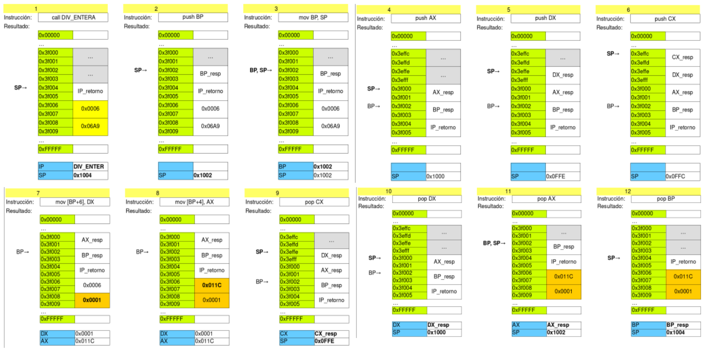

# Funciones y datos en Intel 8086

**Fecha:** 09-11-2026

## Introducción

Por definición, una variable es un espacio en memoria con un nombre asignado. En alto nivel, todos conocemos el concepto de variable. En assembler, esto se mapea a posiciones de memoria con una etiqueta.
El tipo de una variable de alto nivel se refleja con el tamaño que ocupan en memoria.
Tampoco hay *new* o *delete*, son funciones de alto nivel.

Las variables siempre tienen una posición de memoria asignada. En base a su alcance, decidiremos si almacenarla en memoria, stack o registro.
Por ejemplo: una variable con alcance (scope) corto, podremos ubicarla únicamente en un registro; mientras que por otra parte, una variable global si o si debe tener espacio en la memoria principal.

## Tipos de datos

Muchos de los conceptos vertidos en esta clase son de alcance general, pero nos restringiremos solamente a la arquitectura Intel 8086.

### Tipos básicos

Tenemos solo dos tipos básicos de acuerdo al tamaño de palabra de la arquitectura:

- char (1 byte)
- unsigned short o short (2 bytes)

### Punteros

Los punteros en Intel 8086 pueden ser:

- en el mismo segmento (2 bytes para el desplazamiento)
- en otro segmento (4 bytes: 2 desplazamiento y 2 segmento)

Usualmente se trabaja con punteros en el mismo segmento.

### Arreglos

Para compilar un arreglo en Intel, disponemos un elemento del arreglo a continuación del otro. Cada elemento del arreglo ocupa lo que ocupa el tipo de datos del arreglo.
Veamos por ejemplo, como sumar 10 elementos de un arreglo de enteros que comienza en [BX]:

```asm
MOV SI, 0
MOV AX, 0
MOV CX, 0
evaluar:
  CMP CX, 10
  JZ fin
  ADD AX, [BX+SI]
  ADD SI, 2
  INC CX
  JMP evaluar
```

### Structs

Para compilar un struct en Intel 8086, disponemos un elemento del struct a continuación del otro en el orden en el que fueron declarados. El struct ocupa la suma de lo que ocupan sus elementos.

**Ejemplo:** Acceso a los componentes de un struct ubicado en [BX]:

```c
struct ejemplo {
  short x,y;
  char a,b;
} // ocupa 6 bytes
```

```asm
; si BX apunta al inicio
mov AX, [BX] ; x
mov AX, [BX+2] ; y
mov AX, [BX+4] ; a
mov AX, [BX+5] ; b
```

### Compilar tipos compuestos

Nos referimos a tipos compuestos a aquellos que utilizan más de un tipo estructurado en su definición. Para compilarlos, seguiremos las pautas planteadas para cada uno de los tipos, teniendo en cuenta únicamente que sus componentes no son tipos básicos.

**Ejemplo:** Sumar 10 componentes enteros de un arreglo de structs que comienza en [BX]:

```c
typedef struct {
  char a;
  short x;
} ejemplo
ejemplo arreglo[10];
```

```asm
MOV SI, 0
MOV AX, 0
MOV CX, 0
evaluar:
  CMP CX, 10
  JZ fin
  ADD AX, [BX+SI+1]
  ADD SI, 3 ; tamaño del elemento
  INC CX
  JMP evaluar
fin:
```

## Funciones

Como la mayoría de las arquitecturas, Intel 8086 incluye un mecanismo para implementar funciones y llamados.
Difiere de un flujo condicional en cuanto a que se retorna luego de un llamado.

Veamos un ejemplo: ¿Cómo es la secuencia de pasos en este programa?

```c
int sumar(int a, int b) {
  return a+b;
}

int main() {
  ...
  int dato = sumar(4,5);
  ...
}
```

1. Pasar parámetros 4 y 5
2. Saltar a la función suma
3. Ejecutar la función suma
4. Pasar resultado a devolver
5. Volver al punto de invocación
6. Asignar a dato el resultado
7. Continuar con la ejecución del programa

### Pasaje de parámetros

Al llamar una función, es posible pasar los parámetros mediante dos formas:

1. Por REGISTRO. Se cargan los parámetros en registros antes de hacer el llamado.
2. Por STACK. Se hace PUSH de los parámetros antes hacer el llamado.

El retorno del resultado es análogo. Veremos esto más adelante.

---

El mecanismo para el llamado de funciones en Intel es naturalmente el **stack**.
Es la herramienta que provee la arquitectura para guardar el contexto del llamador (en particular, la posición actual).

Las dos instrucciones para implementar llamados a funciones son:

1. CALL: Realiza el llamado
2. RET: Devuelve el control al llamador

### CALL

CALL permite invocar una rutina definida mediante la directiva PROC. Para esto, sencillamente realiza el PUSH de la posición actual en la ejecución y salta a la etiqueta.

1. PUSH IP
2. JMP etiqueta

**CALL FAR:** Si para invocar la rutina se debe cambiar el valor de CS, el call modifica su comportamiento: también hace push del CS.

1. PUSH CS
2. PUSH IP
3. JMP funcion (nuevo CS e IP)

### RET

RET nos permite volver al punto anterior de ejecución. Para esto, toma del tope del stack la dirección de retorno y vuelve hacia allí.

1. POP IP

Notar que el RET asume que lo que se encuentra en el tope del stack, es la dirección de retorno. Si es otra cosa, el sistema tendrá un comportamiento desconocido.
¿Qué pasa si hay que retornar de un CALL FAR?

---

Definimos el protocolo de recibir los parámetros en AX y BX respectivamente, devolviendo el resultado en AX.

```asm
PROC sumar:
  ADD AX, BX
  RET
ENDPROC

PROC main:
  ...
  MOV AX, 4
  MOV BX, 5
  CALL sumar
  ...
; AX es 9
```

### Contexto de ejecución

El contexto de ejecución consiste en el valor de los registros del CPU. Esto incluye los registros de datos así como los registros de estado.
Este concepto también existe en alto nivel y se relaciona con el alcance de una variable.

Por lo general, cuando llamamos a una función en alto nivel, al retornar, nuestras variables valen lo mismo antes y después del llamado.
Por otra parte, en bajo nivel y en particular con Intel 8086, al ejecutar una función el valor de los registros (contexto) no se preserva automáticamente como en alto nivel.

```asm
PROC sumar:
  XOR CX, CX
  ADD AX, BX
  RET
ENDPROC

PROC main:
  MOV CX, 30
  MOV AX, 4
  MOV BX, 5
  CALL sumar
; AX = 9 y CX = 0
```

En Intel 8086, la herramienta que se utiliza para preservar el contexto es el stack. Intel preserva el contexto mínimo de la función "padre", esto es: el punto de ejecución previo a la llamada (a dónde volver luego).
El programador debe preservar manualmente el contexto, pero es una tarea opcional.

En términos generales, el procedimiento es:

1. Al comenzar la función, almacenar en el stack el valor de todos los registros que se utilizan.
2. Ejecutar el cuerpo de la función.
3. Restaurar desde el stack en *orden inverso* los registros utilizados.
4. Retornar (el tope del stack debe contener el IP anterior)

Existen excepciones, como por ejemplo si un registro se utiliza para devolver el resultado (como AX en la suma).

Veamos dos ejemplos que preservan y no preservan el contexto respectivamente:

#### Preserva contexto

```asm
PROC sumar:
  PUSH CX
  PUSH DX
  XOR CX, CX
  ADD DX, DX
  ADD AX, BX
  POP DX
  POP CX
  RET
ENDPROC

PROC main:
  MOV AX, 4
  MOV BX, 5
  MOV CX, 30
  MOV DX, 40
  CALL sumar
; AX = 9, BX = 5, CX = 30, DX = 40
```

#### No preserva contexto

```asm
PROC sumar:
  XOR CX, CX
  ADD DX, DX
  ADD AX, BX
  RET
ENDPROC

PROC main:
  MOV AX, 4
  MOV BX, 5
  MOV CX, 30
  MOV DX, 40
  CALL sumar
; AX = 9, BX = 5, CX = 0, DX = 80
```

### Pasaje de parámetros

Como ya se mencionó anteriormente, los parámetros se pueden pasar tanto por stack como por registros. Las funciones pueden utilizar simultáneamente ambos mecanismos.

#### Pasaje por registros

Al definir una función, podemos especificar los registros utilizados para el intercambio de información. Para el caso de *sumar* del ejemplo anterior:

> SUMAR es una función que preserva el contexto, recibe en AX y BX los operandos a sumar y retorna en AX el valor de la suma.

El pasaje por registros de parámetros y resultados tiene dos inconvenientes principales:

1. **Pocos registros:** La cantidad de parámetros a pasar es muy limitada.
2. **Liberar registros para resultado:** Para retornar resultados, el llamador debe liberar registros.

#### Pasaje por stack

El mecanismo más flexible para el pasaje de parámetros y retorno de resultados es el stack.
El esquema básico para el llamado de una función que recibe y devuelve los parámetros por stack es:

1. **PUSH de parámetros:** Antes de invocar la función, se realiza el push de los parámetros al stack.
2. **Invocación:** La rutina invocada puede o no preservar el contexto.
3. **Retorno y POP de resultados:** Al retornar al llamador, en el tope del stack se encuentran los resultados.

Al especificar la firma de la función, en el caso de utilizar el stack para el pasaje de parámetros se debe especificar **la cantidad y el orden de los mismos**. Aplica lo mismo para el resultado. Notar que la cantidad de parámetros y resultados es independiente.

> **Ejemplo:** DIV-ENTERA es una función que preserva el contexto, recibe en el stack DIVIDENDO y DIVISOR con el último en el tope. Devuelve RESTO y COCIENTE con el último en el tope.

Otra manera de expresar lo mismo es abusar un poco de la notación:

```asm
PUSH dividendo ; PUSH op1
PUSH divisor ; PUSH op2
CALL div-entera
POP cociente ; POP res1
POP resto ; POP res2
```

Es natural que ahora surja la duda sobre como accedemos a los parámetros pasados por el stack desde la función, si en el tope del stack tenemos la dirección de retorno que es puesta por el CALL.

Para poder manipular el stack y sus parámetros, usaremos BP. Cargaremos BP con una posición conocida (SP) que nos permita acceder a otras posiciones del stack.

```
PROC div-entera
  PUSH BP ; respaldo
  MOV BP, SP
  ; SS:[BP] -> posición actual stack
  ; SS:[BP+2] -> dirección retorno
  ; SS:[BP+4] -> divisor
  ; SS:[BP+6] -> dividendo
```

A continuación detallamos el ejemplo completo de div-entera con la especificación que vimos anteriormente con los parámetros DIVIDENDO=1705 y DIVISOR=6:

```asm
PROC div-entera
  PUSH BP ; respaldo
  MOV BP, SP
  PUSH AX ; respaldo
  PUSH DX ; respaldo
  PUSH CX ; respaldo
  MOV DX, 0
  MOV AX, [BP+6]
  MOV CX, [BP+4]
  DIV CX ; ver cartilla
  ; DX=0x1 (resto), AX=0x11C (cociente)
  MOV [BP+6], DX
  MOV [BP+4], AX
  POP CX
  POP DX
  POP AX
  POP BP
  RET
ENDPROC
```

Podemos ver en la siguiente imagen cada paso de la ejecución de la rutina para entender el funcionamiento.



#### Ajuste de stack

Cuando la cantidad de parámetros y de resultados son diferentes, es necesario manipular el stack para ajustarlo, de forma tal que al ejecutar RET se encuentre la dirección de retorno en el tope del stack y debajo estén los resultados.
Veamos un ejemplo con más parámetros que resultados:

```asm
PUSH minuendo ; PUSH op1
PUSH sustraendo ; PUSH op2
CALL resta ; preserva contexto
POP diferencia ; POP res1
```

Haciendo doble click sobre el procedimiento "resta":

```asm
PROC resta
  PUSH BP ; respaldo
  MOV BP, SP
  PUSH CX ; respaldo
  MOV CX, [BP+6]
  SUB CX, [BP+4]
  MOV [BP+6], CX
  MOV CX, [BP+2] ; CX = direccion retorno
  MOV [BP+4], CX ; [BP+4] = direccion retorno
  POP CX
  POP BP
  ADD SP, 2 ; ajuste de stack
  RET
ENDPROC
```

**Nota:** En caso de tener más resultados que parámetros se deben reservar posiciones de stack al inicio de la rutina.

## Recursión

Un tipo especial de rutinas son las recursivas. Nos interesará sobre las mismas su comportamiento y su consumo de stack.
En particular nos interesa conocer su máximo consumo posible de stack.

### Ejemplo

Estudiaremos el funcionamiento de las rutinas recursivas mediante un ejemplo: el factorial.

> FACT es una función que recibe en AX un número positivo mayor o igual a 0 y devuelve en BX su factorial. No preserva registros

En alto nivel, la función es la siguiente:

```c
short factorial(short n) {
  if (n==0) {
    return 1;
  } else {
    return n * factorial(n-1);
  }
}
```

#### Compilación #1

**Llamada**

```asm
MOV AX, n
CALL fact
MOV resultado, BX
; con n y resultado como etiquetas
```

**Ensamblador**

```asm
fact PROC
  CMP AX, 0  ; caso base
  JZ esCero
  DEC AX     ; ajusto parámetro para llamada recursiva
  CALL fact
  INC AX     ; reajusto parámetro post llamada recursiva
  MOV CX, AX ; guardo AX pues MUL lo modifica
  MUL BX     ; cálculo del factorial
  MOV BX, AX ; asigno el resultado a BX
  MOV AX, CX ; restauro AX
  JMP fin
esCero:
  MOV BX, 1  ; resultado del paso base
fin:
  RET
fact ENDP
```

Como mencionamos anteriormente, nos interesa el consumo de stack en bytes. Para calcular el consumo para $n$ necesitamos dos pasos:

1. Consumo de paso base: $\text{consumo}(0)=2$. Los 2 bytes que se utilizan para almacenar el IP al hacer el CALL.
2. Consumo de paso inductivo: $\text{consumo}(n)=2+\text{consumo}(n-1)$. Los dos bytes para el CALL interno (post JZ).

Con esto podemos concluir que $\text{consumo}(n)=2+2n$ (se podría probar por inducción completa)

#### Compilación #2

Veamos otra compilación posible, que utiliza el stack para preservar AX.

**Llamada**

```asm
MOV AX, n
CALL fact
MOV resultado, BX
; con n y resultado como etiquetas
```

**Ensamblador**

```asm
fact PROC
  CMP AX, 0
  JZ esCero
  PUSH AX    ; respaldo
  DEC AX     ; ajusto parámetro para llamada recursiva
  CALL fact
  POP AX     ; restauro respaldo
  MUL BX     ; cálculo del factorial
  MOV BX, AX ; asigno el resultado a BX
  JMP fin
esCero:
  MOV BX, 1  ; resultado del paso base
fin:
  RET
fact ENDP
```

Sobre el consumo:

1. $\text{consumo}(n)=2$
2. $\text{consumo}(n)=4+\text{consumo}(n-1)$
3. $\text{consumo}(n)=4n+2$

#### Compilación #3

Veamos otra compilación posible, que utiliza el stack para el pasaje de parámetros y para los resultados.

**Llamada**

```asm
PUSH n
CALL fact
POP resultado
; con n y resultado como etiquetas
```

**Ensamblador**

```asm
fact PROC
  POP DX     ; saco dirección de retorno
  POP AX     ; guardo parámetro en AX
  PUSH DX    ; acomodo dirección de retorno en stack
  CMP AX, 0
  JZ esCero
  PUSH AX    ; guardo el contexto
  DEC AX     ; ajusto parámetro para llamada recursiva
  PUSH AX    ; parámetro en stack para llamada recursiva
  CALL fact
  POP BX     ; guardo en BX el resultado de fact(n-1)
  POP AX     ; restauro el contexto
  MUL BX     ; cálculo del factorial
  MOV BX, AX ; asigno el resultado a BX
esCero:
  MOV BX, 0  ; resultado del paso base
fin:
  POP DX     ; saco dirección de retorno
  PUSH BX    ; guardo resultado en el stack
  PUSH DX    ; guardo dirección de retorno
  RET
fact ENDP
```

Sobre el consumo:

1. $\text{consumo}(0)=4$
1. $\text{consumo}(0)=4+\text{consumo}(n-1)$
1. $\text{consumo}(0)=4+4n$