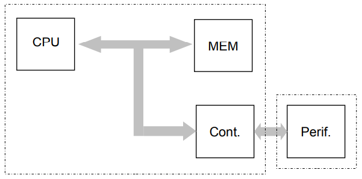
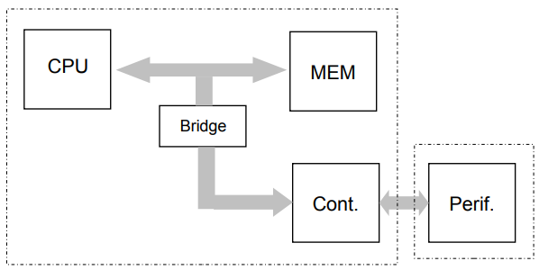
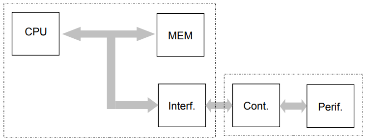
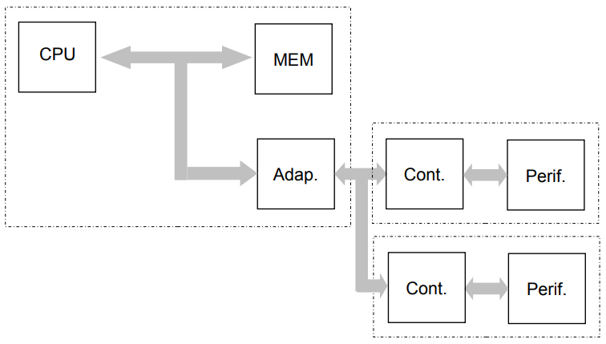
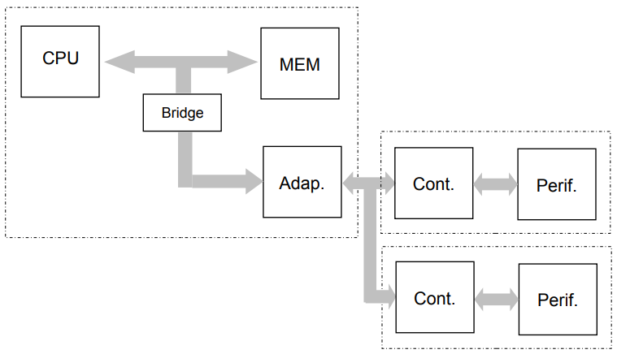

# Entrada/Salida

**Fecha:** 12-11-2026

## Introducción

En esta clase vamos a completar la presentación de la arquitectura Von Neumann, introduciendo la parte de Entrada/Salida, encargada de vincular a la computadora (hasta ahora conjunto CPU+memoria) con el mundo exterior.

La entrada/salida (habitualmente E/S) actúa como interfaz entre los programas que ejecuta la CPU en base a las instrucciones y los datos almacenados en la memoria, con los dispositivos que permitirán interactuar con el mundo físico; permitiendo así, por un lado introducir la información a procesar en el sitema (entrada) y por otro presentar el resultado de ese proceso de modo inteligente para que el ser humano lo pueda procesar.

Los dispositivos que permiten la interacción del usuario con el sistema se denominan **periféricos**.

## Buses

La conexión del CPU, la memoria y la E/S, se realiza mediante grupos de "líneas" que comunican tres tipos de información: **dirección, datos y control**. Esta agrupación se denomina **bus**.

Por lo tanto, en este bus princiapal pueden distinguirse tres buses secundarios:

- **bus de direcciones:** formado por las líneas de conexión que transportan las direcciones de memoria o E/S a ser accedidas durante la transferencia.
- **bus de datos:** formado por las líneas de conexión que transportan la información que es transferida sobre el bus entre los distintos componentes conectados
- **bus de control:** formado por las líneas de conexión que transportan señales que controlan el uso del bus y la comunicación sobre el mismo. Algunas de las señales típicas presentes en este bus son:
    - *Memory_Read:* indica una operación de lectura sobre la memoria
    - *Memory_Write:* indica una operación de escritura sobre la memoria
    - *I/O_Read:* indica una operación de lectura sobre la entrada/salida
    - *I/O_Write:* indica una operación de escritura sobre la entrada/salida
    - *Bus_Request:* indica que un sub-sistema desea tomar control del bus para iniciar una transferencia
    - *Bus_Grant:* indica que el bus está disponible para quién lo solicitó
    - *Transfer_ACK:* confirma la recepción de una transferencia de información
    - *Interrupt_Request:* indica un pedido de interrupción desde un sub-sistema hacia la CPU
    - *Interrupt_ACK:* confirma la aceptación del pedido de interrupción
    - *Clock:* sincroniza las actividades del bus y sus señales
    - *Reset:* fuerza el reset de todos los componentes conectados al bus

El bus de direcciones transporta información que permite identificar y seleccionar las posiciones de memoria a leer/escribir y/o las entidades de E/S con las que se va a interactuar. El bus de datos transporta los datos leídos o a escribir, ya sea en la memoria o en los dispositivos de E/S (transpaso de información entre los subsistemas). El bus de control permite la administración de la comunicación entre la CPU, memoria y la E/S.

En general un bus está definido por un conjunto de características que incluyen:
- especificaciones mecánicas (conectores)
- especificaciones eléctricas (niveles de voltaje y/o corriente), bits de dirección y de datos y consideraciones de "timing" de las señales involucradas incluyendo el reloj de sincronismo.
- protocolo de comunicaciones

En particular, cuando hablamos del "protocolo de comunicaciones" nos estamos refiriendo al conjunto de reglas que debe seguir cualquier entidad conectada al bus para hacer uso del mismo a los efectos de realizar un intercambio de información con otra entidad.

Según sea el tamaño del sub-bus de datos se habla de buses de 16, 32 o 64 bits (estos son los tamaños habituales al presente). También caracteriza a un bus si el sub-bus de datos es separado del sub-bus de direcciones o está multiplexado en el tiempo con él. En particular estas dos características, unidas a la frecuencia del reloj utilizado para el sincronismo, determinan la capacidad de transferencia de información del bus.

Según sean las características del protocolo de comunicaciones se distinguen distintos tipos de buses. Una primera clasificación posible es según su complejidad:

- **Bus simple:**
    Este tipo de buses se implementan en una filosofía "Master-Slave". Existe una sola entidad que controla el uso del bus en todo momento (el "master"), típicamente la CPU, quién inicia, controla y participa de todas las transferencias que se realizan en el bus. Todas las transacciones sobre el bus se realizan bajo su supervisión. Las entidades "esclavas" que deseen utilizar el bus tienen que esperar ser habilitas por el "maestro", el cual o bien utiliza técnicas de "polling" (consulta) para determinar si una entidad esclava desea hacer una transferencia o bien dispone de algún mecanismo por el cual la entidad interesada en realizar una transferencia le avisa de este interés (por ejemplo mediante un pedido de interrupción)
- **Bus inteligente:**
    En estos buses cualqueir entidad conectada puede tener, al menos potencialmente la capacidad de convertirse en el "master" del bus (se dice que tiene la capacidad de "bus mastering") y comandar una transferencia. Al momento que una o varias entidades requieren hacer uso del bus ocurre una competencia por el uso del mismo, la cual es resuelta por un mecanismo de arbitraje que determina cuál de los contendientes pasa a ser el "master", mientras que el resto permanecerá como "slave" hasta que se termine la transacción.
    En función de como sea este mecanismo de arbitraje se distinguen, a su vez, las siguientes categorías de bus inteligentes:
    - **Bus con arbitraje centralizado:** un bus con este tipo de arbitraje se denomina *Jerárquico*. En estos buses hay una entidad que tiene mayor jerarquía que las demás (típicamente la CPU) y es la responsable de entregar el control del bus a las entidades que lo requieran. La entidad interesada en utilizar el bus le avisa de este interés ("bus request") y el árbitro la habilita a utilizarlo ("bus grant").
    - **Bus con arbitraje distribuido:** un bus con este tipo de arbitraje es denominado *Equitativo*. En estos buses todas las entidades conectadas tienen el mismo "rango" y no existe un árbitro central, sino que el mecanismo de asignación del bus tiene su inteligencia distribuida entre todas las entidades con capacidad de "bus mastering". Cuando dos o más entidades requieran simultáneamente del bus se aplica un mecanismo de arbitraje que determina cuál de los contendientes por el uso del bus tendrá el control del mismo en ese momento y cuál(es) tendrá(n) que esperar hasta que quede liberado nuevamente. Este arbitraje, a diferencia del caso anterior, se resuelve por una especie de votación entre los distintos contendientes, sin la necesidad de contar con un árbitro fijo y central.

Existe otra clasificación de los buses que apunta a categorizarlos según sea la aplicación a la que se destinan, en función de la ubicación de las entidades a conectar en relación a lo que se podría definir como "frontera" del sistema. Si bien esta clasificación es discutible y eventualmente varía con el tiempo o con el alcance de lo que consideremos por "sistema, los buses se suelen distinguir entre:
- **Internos:** cuando se utilizan para conectar sub-sistemas dentro de la "frontera" del sistema. El caso más típico e indiscutible de un bus interno es el "bus de memoria" (que conecta la CPU con los bancos de memoria).
- **Externos:** cuando se utilizan para conectar sub-sistemas fuera de dicha frontera. Los casos más típicos y claros de este tipo de buses lo constituyen el bus SCSI (Small Computer System Interface) que se puede utilizar para conectar dispositivos de almacenamiento masivo (discos rígidos y unidades de cinta); y el bus USB (Universal Serial Bus) que se puede utilizar para conectar una variedad muy amplia de dispositivos.

## Controladores de E/S

La arquitectura de E/S maneja el concepto de "controlador de E/S". Un controlador de E/S es la parte del periférico que contiene su inteligencia y por lo tanto lo "controla".

### Conexión a los cotroladores de E/S

Existen distintas variedades en la forma que un controlador se conecta con un computador, en particular teniendo en cuenta su lugar de residencia: si en el gabinete del periférico, si en el gabinete del computador o distribuido entre ambos.
Veremos a continuación la representación esquemática de algunos de estos casos:

#### El controlador de E/S está contenido en el gabinete del computador

1. El controlador de E/S está conectado directamente al bus del sistema.

2. El controlador de E/S está conectado a un bus distinto al bus interno del sistema, el cual se conecta al bus interno a través de un adaptador usualmente llamado "bridge" (puente).

#### El controlador de E/S está contenido en el gabinete del periférico

En este caso no se da la situación de que el controlador de E/S pueda estar conectado directamente al bus interno del sistema, porque dicho bus no está diseñado para soportar largos recorridos de la señal. Por eso se requiere una interfaz o un bus del tipo externo que habilite la conexión. La diferencia entre interfaz y bus es que la interfaz permite la conexión de un único dispositivo, por lo que su protocolo de comunicaciones es más sencillo y no necesita de un algoritmo de administración del uso compartido.

Podemos distinguir las situaciones:

1. Se utiliza una interfaz conectada directamente al bus interno del sistema

2. Se utiliza un adaptador de bus conectado directamente al bus interno del sistema

3. Se utiliza un adaptador de bus conectado a un bus distinto del bus interno

#### El controlador de E/S está distribuido entre el gabinete del computador y el del periférico

Es el caso del teclado de una computadora personal, donde parte de la inteligencia reside en el propio teclado (posee un microcontrolador que realiza el barrido de las teclas para determinar si hay alguna presionada) y parte en la placa prinipal de la computadora (donde otro microcontrolador realiza algunas funciones de conversión de códigos y repetición de teclas).

### Acceso a los controladores de E/S

La comunicación de la CPU con los controladores E/S se realiza a través de posiciones de memoria especiales de estos dispositivos, las que son accesibles también para la CPU. Existen dos tipos de arquitecturas de E/S respecto a la forma de acceso desde la CPU:

1. La CPU dispone de un espacio de direcciones reservado para la E/S, el cual es accedido por instrucciones especialmente destinadas para ese fin (típicamente identificadas como **in** y **out**). Un ejemplo de este enfoque es la familia de procesadores Intel.
2. La CPU accede a los controladores de E/S como si fueran posiciones normales de memoria, utilizando para tales fines cualquier instrucción que acceda a memoria. Un ejemplo de este diseño son la mayoría de las arquitecturas RISC.

Al igual que en la CPU, estas memorias especiales de los controladores de E/S se llaman genéricamente **registros**. Normalmente un controlador de E/S tiene un conjunto relativamente pequeño de registros para implementar el intercambio de información con la CPU.
Una excepción a esta regla la constituyen los controladores de video, que por requerir grandes volúmenes de información necesitan espacios de direcciones más amplios. Esto representa alguna dificultad de implementación en las arquitecturas Intel (porque el espacio de direcciones reservado a E/S es pequeño) por lo que en los PCs se adoptó una estrategia de las memorias de video en el espacio de direcciones de memoria de la CPU (en vez de utilizar el espacio de E/S).

Una propiedad interesante de los registros de E/S es que aún en el caso en que se acceden como memoria, **no se comportan como memoria**, pudiendo tener comportamientos bien diferentes tales como:

- **solo lectura:** el registro solo puede ser leído y si se escribe en él no se logra ningún efecto
- **solo escritura:** el registro solo puede ser escrito y si se lee se obtiene un resultado impredecible
- **lectura/escritura independiente:** en este caso se tienen dos registros diferentes, uno de solo lectura y otro de solo escritura accesibles en la misma dirección de E/S. Por lo que si bien se puede escribir y leer en la misma dirección, las posiciones de memoria accedidas son separadas e independientes, por lo que obviamente lo que se escribe no puede ser leído posteriormente.
- **lectura/escritura normal:** estos registros de E/S se comportan como una posición de memoria normal, lo que se escribe puede ser leído más tarde.

Otra característica importante a tener en cuenta cuando se accede a E/S es que muchas veces hay bits que no están definidos, por lo que al leerlos juntos en un byte o una palabra pueden tomar cualquier valor, con lo que la comparación del contenido del byte debe hacerse mediante el uso de **máscaras** (haciendo el AND bit a bit con un valor que tenga en uno aquellos bits que nos interesan). Algo similar ocurre al escribir, en algunos registros determinados bits que no están definidos deben, de todos modos, escribirse en un valor determinado.

La cantidad de registros y su función dependen fuertemente de cada controlador y de la aplicación que tenga el mismo. De todos modos hay algunos registros característicos que están presentes en muchos de ellos:

- **datos entrada:** este registro contiene un dato destinado a la CPU, proveniente del periférico, del propio controlador o de la línea de comunicaciones.
- **datos salida:** este registro contiene un dato proveniente de la CPU y destinado al periférico, al propio controlador o a la línea de comunicaciones.
- **estado:** este registro contiene bits que indican el estado del controlador en si mismo o del periférico que controla (ej: si hay un dato en el registro de entrada, si está libre el registro de salida, si hay un pedido de interrupción pendiente, si hay alguna condición de error en el controlador o el periférico, etc.).
- **control:** este registro contiene bits que le indican al controlador de E/S o al periférico realizar determinada acción (ej: ponerse en línea, reiniciarse, que lea el dato del registro de salida)