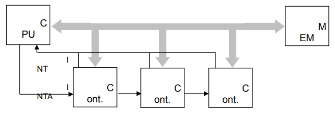
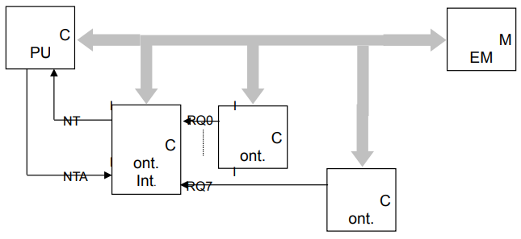
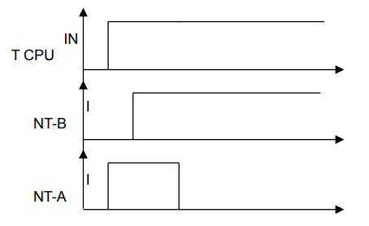

# Interrupciones

**Fecha:** 16-11-2026

## Introducción

En este capítulo veremos el último de los componentes esenciales de la arquitectura Von Neumann: el manejo de interrupciones.
Este concepto es habitualmente díficil de entender en los cursos básicos de computación porque se aparta de lo que intuitivamente pensamos de la ejecución de un programa: siempre pensamos que la próxima instrucción (o sentencia) que se ejecuta de un programa es la que está escrita a continuación en el código, o siendo más precisos, la que está a continuación en la lógica de ejecución del programa.
Sin embargo esto no es cierto justamente debido al mecanismo de interrupciones que se utiliza en todos los sistemas que se basan en los conceptos de programa almacenado.

## Definición

Una definición de interrupción puede ser:

> Una interrupción consiste en un mecanismo que provoca la alteración del orden lógico de ejecución de instrucciones como respuesta a un evento externo, generado por el hardware de entrada/salida en forma asincrónica al programa que está siendo ejecutado y fuera de su control.

En forma alternativa, se puede decir que:

> Una interrupción consiste en un mecanismo que le permite al hardware la invocación de una rutina fuera del control del programa que está siendo ejecutado.

Analicemos el contenido de la primera definición que hemos dado. Por un lado decimos que se trata de un mecanismo, cuyos detalles veremos más adelante, que provoca **la alteración del órden lógico de ejecución de instrucciones**. Esto significa que cuando ocurre una interrupción, la próxima instrucción a ser ejecutada **no** es la que corresponde a la secuencia lógica de instrucciones del programa que se está ejecutando, que vendría a ser la apuntada por IP, sino que dicha secuencia se modifica y se pasa a ejecutar otra instrucción (concretamente la primera de la **rutina de servicio de la interrupción** correspondiente al pedido atendido).

Por otro lado nos referimos a que es en respuesta a un *evento externo*, que está generado por el hardware de entrada/salida, es decir que no es el programa que lo genera (al menos no en forma directa), siendo provocado por el hardware, en particular el asociado a los dispositivos de entrada/salida, más concretamente: los controladores de E/S.

Y finalmente se menciona que es *asincrónico y fuera de su control*, lo que significa que el programa que está siendo ejecutado no tiene control sobre el momento en que este mecanismo se dispara, ni sobre la propia ocurrencia del fenómeno. Es decir que en particular, no hay sincronismo entre la ejecución del programa y la eventual invocación a esa rutina "especial" disparada por la interrupción.

## Pedido de interrupción

El mecanismo de interrupción comienza con el pedido de interrupción (interrupt request) generado por un controlador de entrada/salida.

Este pedido se genera a raíz de alguna condición detectada por el controlador (ej: dispone de un dato para ser leído por la CPU, terminó de ejecutar la lectura del sector de disco solicitada, hay una condición de error en el byte recibido por la línea de comunicaciones, etc.).

Las condiciones que generan el pedido varían de acuerdo al tipo de controlador que se trate y de acuerdo a como esté configurado el mismo. Hay controladores capaces de solicitar iterrupciones ante determinadas y diferentes condiciones de error, pero que pueden ser programados para no hacerlo a través de bits que habilitan/deshabilitan la posibilidad que una situación particular pueda o no generar una interrupción.

Los controladores de E/S disponen de una señal de **salida** (habitualmente denominada INT, INTR o IRQ) que toma el valor "1" cuando el controlador interrumpe. Normalmente esa salida es el reflejo de hardware de un bit del registro de ESTADO. Es decir que el nivel actual (0 o 1) de la señal INT del controlador de E/S puede leerse en un bit de dicho registro. Este bit de "pedido de interrupción pendiente" y su correspondiente reflejo en el hardware permanece en nivel alto hasta que la rutina de atención de la interrupción realice alguna operación sobre los registros del controlador de E/S que satisfaga el pedido, con lo cual el controlador procederá a pasar ese bit (y su salida INT) a 0. Cual es esa acción dependerá del controlador, y posiblemente de la condición que provocó el pedido. Algunos pedidos de interrupción se satisfacen con la lectura del registro de estado, otros requieren de la lectura de algún registro adicional, otros requieren de la escritura de un registro, etc.

En las CPUs también existe esta señal, que recibe denominaciones similares, pero que es de **entrada**. Esta entrada es la que el hardware de la CPU consulta para determinar si hay algún pedido de interrupción por parte de algún controlador de E/S.

Luego lo veremos en mayor detalle, pero adelantaremos que la CPU chequea la existencia de un pedido de interrupción al finalizar la ejecución de cada instrucción. Si detecta una solicitud, procede a desencadenar el mecanismo que desemboca en la ejecución de la rutina de serivicio de la interrupción, luego de la cual se pasa a ejecutar la próxima instrucción del programa interrumpido, siempre que no exista un nuevo pedido de interrupción, donde en caso de existir, se desencadenará un nuevo proceso de invocación a la rutina de servicio que corresponda.

De acuerdo a la forma en que la CPU detecta que hay un pedido de interrupción se distinguen dos casos: detección por nivel y detección por flanco.

### Detección por nivel

En este caso la CPU reconocerá que hay un pedido de interrupción pendiente, mientras su entrada INT esté en el nivel lógico alto ("1").
Esto significa que toda vez que la CPU detecte esa entrada en alto, desencadenará la invocación a la rutina de atención, incluso cuando haya terminado recién de ejecutar una rutina de interrupción.

### Detección por flanco

En este caso lo que nos interesa a los efectos de determinar que existe un requerimiento de interrupción es la existencia de un cambio de nivel bajo ("0") a alto ("1"), es decir un **flanco** en la entrada INT.

Es decir que no importa el valor absoluto actual de la entrada INT, lo que se tiene en cuenta es si existió un cambio de 0 a 1. Si hubo flanco y aún no ha sido invocada la rutina de atención, la CPU lo hace y da por cumplido el pedido.

Luego veremos que esto tiene sus implicancias en el diseño de rutinas de servicio a las interrupciones.

## Atención del pedido de interrupción

Cuando la CPU reconoce reconoce que hay un pedido de interrupción desencadena el mecanismo de atención a dicha solicitud. Por ahora vamos a considerar que la CPU acepta la interrupción, dejando para más adelante la consideración de en que casos esto ocurre.

Para atender una solicitud de interrupción, la CPU realiza los siguientes pasos:

- "termina" de ejecutar la instrucción actual. Utilizamos las comillas para señalar que en realidad, lo que ocurre es que la CPU consulta si hay un pedido de interrupción al final del ciclo de instrucción, luego de la etapa de *write* y antes del siguiente *fetch*. Esto se traduce en que el pedido de interrupción debe esperar hasta el final de la ejecución de la instrucción para que sea efectivamente detectado como tal.

- salva el valor actual de IP, como forma de poder regresar a ejecutar la siguiente instrucción del programa interrumpido, luego de la ejecución de la rutina de servicio a la interrupción.
Es de destacar que las distintas arquitecturas realizan esta actividad de diferentes formas. Podemos distingir básicamente dos:
  - **utilizando un stack:** esta es la vía habitual en las arquitecturas que implementan un stack por hardware, como el caso de los procesadores Intel.
  - **utilizando un registro:** esta es la vía habitual de las arquitecturas RISC, en particular la SPARC.

  También es de destacar que hay arquitecturas que salvan adicionalmente otros registros. Por ejemplo los procesadores Intel salvan el registro que contiene el estado del CPU (el registro de FLAGS), incluyendo los bits de condición (Zero, Negative, Carry, oVerflow, Sign, etc.) que generó la ALU en la última instrucción ejecutada. En el mismo caso de Intel x86 además, se guarda el registro que contiene el identificador del segmento de código del programa que fue interrumpido, como consecuencia de su modelo de direccionamiento segmentado.

- identifica el controlador de E/S que realizó el pedido de interrupción. Veremos este tema en el siguiente punto.

- obtiene la dirección de la rutina de servicio de la interrupción correspondiente al controlador identificado. También hay varias formas de implementar esto, pero la mayoría son variaciones sobre el concepto de **vector de interrupciones**.
  - la arquitectura Intel x86 utiliza un identificador de 8 bits del pedido de interrupción como índice a una tabla (el vector de interrupciones) que en cada entrada tiene la dirección absoluta de la rutina de interrupción asociada, formada por el segmento y el desplazamiento de la dirección de memoria de la primera instrucción de la rutina de interrupción
  - la arquitectura SPARC utiliza también un identificador de 8 bits para el pedido de interrupción, el cual multiplica por 16 antes de sumarle el valor contenido en un registro especial (el Trap Base Register, o registro base de "traps", el nombre que le da SPARC a las interrupciones) para formar la dirección a la cual se va a pasar el control. De esta forma tenemos una especie de tabla que almacena las primeras 4 instrucciones (SPARC tiene instrucciones de largo fijo de 4 bytes) de cada rutina de interrupción

- enmascara las interrupciones. Esto significa que inhibe la aceptación de nuevos pedidos de interrupciones hasta que ocurra uno de los siguientes eventos:
  - se retorne de la rutina de servicio de la interrupción (todas las arquitecturas tienen una instrucción específica para hacer esto), o
  - el código de la rutina de servicio habilite de forma explícita (a través de una instrucción) la posibilidad de aceptar nuevas interrupciones.

  Esto lo hace con la intención de que múltiples interrupciones simultáneas (desde el punto de vista del mecanismo de detección) no sobre-escriban los lugares que se están utilizando para salvar el puntero de instrucción u otros registros vitales para poder retomar sin inconvenientes el programa originalmente interrumpido.
  De esta forma le permiten a la rutina de interrupción tomar los recaudos apropiados para evitar esto y recién luego, si corresponde y tiene sentido para el sistema en su globalidad, proceder a habilitar nuevamente las interrupciones.

- pasa a ejecutar la rutina de servicio a la interrupción (o rutina de interrupción), cargando en el puntero de instrucción la dirección a la primera instrucción de dicha rutina.

## Identificación del controlador que solicita la interrupción

Es normal que un sistema tenga múltiples controladores de E/S. Por tanto hay que tener un mecanismo que permita saber que controlador de E/S generó un pedido concreto mediante el mecanismo de interrupción.

Las soluciones a este problema son variadas y se dividen en: basadas en hardware y basadas en software.

### Identificación por hardware

#### Lineas INT/IRQ independientes en la CPU

En este caso el propio CPU tiene múltiples entradas INT (numeradas, por ejemplo: INT0, INT1, etc.) y la idea es conectar un controlador de E/S a cada una de ellas. La identificación entonces es directa: el controlador que está pidiendo la interrupción es el que está conectado a la entrada INTn donde se detecta la solicitud. En este caso hay una dirección de la rutina de servicio a la interrupción por cada línea de pedido disponible.

En algunos casos, como en el ejemplo de la arquitectura SPARC, las entradas de solicitud de interrupción están codificadas. Esto quiere decir que el SPARC en vez de tener 16 entradas de solicitud independientes, tiene 4 entradas en las cuales se presenta el código binario del pedido de interrupción (código 0 indica que no hay pedido). Esto exige la inclusión de hardware de codificación externo a la CPU de forma de convertir las entradas de solicitud individual a las entradas codificadas de la CPU.

#### Mecanismo INT/INTA

Este mecanismo fue diseñado por Intel para sus primeros microprocesadores de 8 bits (8080 y 8085) y luego mantenido en las sucesivas familias arquitectónicas que los sucedieron. La idea es que el CPU dispone de una única entrada de pedido de interrupción INT, a la cual se conectan en modalidad OR-cableado todos los pedidos de interrupción de los distintos controladores de E/S. También dispone de una salida denominada INTA (Interrupt Acknowledge) que le avisa al controlador de E/S que ha sido aceptada su solicitud de interrupción y le indica con esa señal que coloce en el bus de datos su identificación.
La CPU entonces realiza una lectura del bus de datos y obtiene el identificador.

Este procedimiento se extiende para el caso de múltiples controladores mediante el encadenamiento de las señales INTA (los controladores de E/S que soportan este mecanismo tienen una entrada y una salida INTA) según el siguiente esquema:



De esta manera cuando la CPU inicia el ciclo de atención a un pedido de interrupción y levanta su señal de salida INTA, la misma se va propagando por los distintos controladores de forma encadenada. De esta forma, el primer controlador de la cadena que tenga un pedido de interrupción pendiente procederá a no continuar con la propagación de la señal INTA hacia los restantes controladores y será él quién coloque en el bus de datos su identificador.

Esto establece una prioridad implícita en la forma de interconectar los controladores, ya que los que están más cerca de la CPU tendrán la posibilidad de ser atendidos antes en caso de coincidir en el tiempo con un pedido de otro controlador que esté más distante (en "saltos de INTA") de la CPU.

#### Controlador de interrupciones

En particular se utiliza en la arquitectura x86 como forma de compatibilizar el mecanismo INT/INTA con controladores de E/S que no lo utilicen. La idea es que un controlador de interrupciones posee múltiples líneas de entrada de solicitud INT para la conexión de los pedidos de interrupción de los diferentes controladores de E/S. Tiene a su vez una única salida del pedido de interrupción INT con su correspondiente INTA para implementar el mecanismo de identificación por hardware.



Cuando un controlador de E/S solicita una interrupción, el controlador de interrupciones genera el pedido a la CPU a través de la señal INT. La CPU cuando acepta la interrupción acepta la señal INTA y en ese momento es el controlador de interrupciones quién coloca en el bus de datos la identificación que está asociada a la entrada IRQ por la que llegó el pedido. El controlador de interrupciones es configurable y tiene registros en los cuales se puede almacenar cuál es la identificación que presentará para cada una de las líneas IRQ. De esta forma, al inicializar los contenidos de estos registros se puede configurar dinámicamente cuales identificadores se utilizarán para los distintos controladores de E/S que se conecten en las distintas entradas de requerimiento de interrupción.

### Identificación por software

Esta categoría aplica cuando todos los controladores de E/S conecten su salida de pedido de interrupción en OR cableado a la única entrada INT de la CPU. Más genéricamente aplica cuando hay múltiples controladores conectados en OR a la misma entrada de INT, sea ésta única o no. En esta situación, la rutina de servicio de la interrupción debe tener una parte inicial que consista en el recorrido de los distintos controladores de E/S, leyendo los registros de estado hasta encontrar aquel que tenga su bit de "pedido de interrupción" en "1". En ese caso se invocará a la sub-rutina asociada a ese controlador específico.

Como la entrada de INT es el OR de todos los pedidos de los controladores, para el caso de que la CPU detecte por nivel no corro el riesgo de dejar de atender a algún controlador, aún en el caso en que la estrategia de la rutina de atención sea del estilo "encuentro el primer controlador con solicitud pendiente, lo atiendo y salgo de la rutina de servicio de interrupción". Pero en el caso de la detección por flanco existe ese riesgo que analizaremos a continuación.

Analicemos el siguiente diagrama de tiempos, donde se muestra por un lado las salidas de pedidos de interrupción de dos controladores A y B y por otro el OR de ambas (que es lo que la CPU ve en su entrada INT):



En el diagrama se muestra que primero ocurre el pedido de interrupción del controlador A, el cual provoca que la entrada a la CPU pase también a 1. Antes que la rutina de servicio a la interrupción llegue a ejecutar la acción que satisface el requerimiento del controlador A, el controlador B pasa su salida a 1, indicando que también tiene un pedido de interrupción para ser procesado. Este último pedido no se ve reflejado en la CPU al ser un OR. 
Luego en el diagrama de tiempo se muestra que la salida del controlador A pasa a 0, en el momento que la CPU ejecuta la instrucción que corresponde a lo que el controlador de E/S entiende como condición para dar por satisfecho su requerimiento.
Notemos que si bien INT-A pasa a 0, la entrada de pedido de interrupción a la CPU sigue en 1 (pues INT-B sigue en ese valor)

Analicemos que pasaría si en este momento y en esta situación, enseguida después de haber detectado y procesado el pedido del controlador A, la rutina de servicio de la interrupción termina su ejecución y el control retorna al programa que fue interrumpido.
- Si la detección es por nivel, esto no representa ningún problema, ya que el pedido de interrupción del controlador B sigue vigente y el mecanismo de atención al pedido de interrupción se disparará inmediatamente.
- En cambio, si la detección es por flanco y sucede la situación descripta, la rutina de servicio de la interrupción no será invocada nuevamente, porque a los efectos de la CPU la solicitud del controlador B no existió, ya que el flanco que hubiera generado en la entrada INT quedó "enmascarado" por el nivel alto que ya existía en ese momento como consecuencia del pedido, aún no satisfecho, del controlador A. En otras palabras: el controlador B queda sin ser atendido. Y lo peor de todo, es que si el controlador A (o cualquier otro conectado a esa línea de entrada) pide una nueva interrupción, ésta tampoco sería detectada. Es más: todo el mecanismo de interrupciones queda bloqueado.

Esta situación podría repetirse varias veces, con lo que pareciera no existir solución para el problema; sin embargo, existe una estrategia de diseño de la rutina de servicio que permite que el sistema de pedidos de interrupción no se tranque al utilizar detección por flanco con múltiples controladores en la misma línea de solicitud. Esta estrategia tiene que ver con asegurarse de alguna forma de que la entrada INT estuvo en algún momento en 0, con lo que no interesa el estado de dicha entrada al salir de la rutina de servicio de la interrupción. Si esto ocurrió (INT estuvo en 0 en algún momento), entonces se habrá detectado un nuevo flanco y por tanto si el flanco existió, la rutina de atención será invocada nuevamente.

### Habilitación de interrupciones

La CPU tiene la capacidad de aceptar o no los pedidos de interrupción de los controladores de E/S. Esta capacidad está implementada de dos maneras, una general y otra selectiva, a las que denominaremos enmascaramiento y deshabilitación.

- **Enmascaramiento:** En este caso la CPU posee la propiedad de poder inhibir la aceptación de todas las solicitudes de interrupción, sin importar de que controlador provengan. Esto se realiza a través del valor de un bit de máscara de interrupción (que recibe el nombre de IM = Interrupt Mask, EI = Enable Interrupt, IF = Interrupt Flag en x86m, etc., dependiendo de la arquitectura), normalmente perteneciente al registro de estado de la CPU (FLAGS). Para determinar si hay un pedido efectivo de interrupción, la CPU hace un AND de la señal de pedido interno de INT con el valor de este bit y utiliza el resultado para tomar la decisión.
Si el bit está 0 no existirá un pedido efectivo (por más que haya controladores de E/S solicitando interrupción). Si está en 1 los requerimientos de interrupción que hubiera serán procesados.
El valor de este bit se cambia mediante instrucciones específicas del set de instrucciones del procesador. A estas instrucciones las denominamos **enable** y **disable**. En un lenguaje de alto nivel las representaremos por procedimientos **enable()** y **disable()**.
La CPU pone automáticamente a 0 este bit al invocar la rutina de servicio de la interrupción. Por ello, una **rutina de interrupción comienza su ejecución con las interrupciones deshabilitadas** y así continuarána menos que explícitamente sean habilitadas por el código de la propia rutina. La instrucción que provoca la finalización de la rutina de interrupción y el retorno a la ejecución del programa interrumpido vuelve a recuperar el valor anterior del bit (1).
También es de señalar que cuando una CPU comienza a funcionar (se le aplica energía por primera vez) también arranca con las interrupciones enmascaradas.
En todas las CPU existe una entrada, independiente de la INT, denominada **NMI** (Non Maskable Interrupt) que trabaja en forma independiente de la máscara de inhibición y un pedido que sea presentado por ella será siempre procesado. La idea de esta entrada es conectar a ella pedidos de interrupción críticos (tales como la falla de la fuente de alimentación o la detección de un error de paridad en la memoria). En la práctico la arquitectura de computadoras tipo PC no la utilizan.
- **Deshabilitación:** En este caso se actúa sobre los controladores de E/S en forma individual, de forma de inhibir su eventual pedido de interrupción. Los controladores de E/S tienen habitualmente un bit en su registro de CONTROL que actúa como máscara para su salida de pedido de interrupción. De hecho la salida tendrá el valor resultante de la ecuación

  ```salida INT = bit INT registro de ESTADO AND MASK_INT registro de CONTROL```

  Notemos que el bit que refleja de condición de "pedido de interrupción pendiente" del registro ESTADO sigue reflejando si el controlador requiere de la intervención de la CPU. Lo que sucede es que la salida del hardware hacia la CPU queda condicionada al valor del bit de habilitación del registro CONTROL.
  Este mecanismo permite al programador tener poder de decisión selectivo sobre que controladores de E/S podrán generar pedidos de interrupción y cuales no.
  El bit MASK_INT descripto inhibe totalmente la generación de interrupciones por parte del controlador E/S. Algunos controladores de E/S disponen también de otros bits de máscara que actúan a nivel diferenciado sobre las distintas posibles condiciones que generan interrupciones. Por ejemplo en un controlador de comunicaciones se pueden generar interrupciones por distintos motivos: recepción de un carácter, error en la línea de comunicaciones, carácter transmitido, cambio en las líneas de control de la comunicación, etc. y el controlador puede tener bits que inhiban de forma individual la generación de solicitudes de interrupción asociadas a cada condición.

## Prioridades

Existen dos situaciones que pueden llevar al mecanismo de interrupciones a tener que tomar una decisión acerca de como proceder:

- hay dos (o más) solicitudes de interrupción simultáneas
- hay una (o más) solicitud de interrupción mientras se está ejecutando una rutina de servicio de una interrupción previa y las interrupciones han sido habilitadas

En cualquiera de ellas, la decisión dependerá de la existencia de prioridades entre los distintos requerimientos.

### Interrupciones simultáneas

Cuando una CPU o un controlador de interrupciones implementa un mecanismo de prioridades, éste determinará cual de múltiples solicitudes que ocurran a la misma vez será atendida.
Es de notar que el concepto de simultaneidad no implica necesariamente que los pedidos de interrupción lleguen exactamente en el mismo instante de tiempo, sino que lleguen durante el período entre una verificación y otra por parte del CPU, la cual puede estar postergada en el tiempo si las interrupciones están deshabilitadas.

El mecanismo de prioridades puede adoptar distintas estrategias: prioridad fija, prioridad configurable o sin prioridad.

- Cuando la prioridad es **fija** siempre será atendida la solicitud que provenga de una línea de pedido que tenga mayor jerarquía. Normalmente se utiliza la numeración de las entradas para fijar su prioridad.
- Cuando la prioridad es **configurable**, la misma se puede cambiar en función de las condiciones del sistema en general.
- Cuando el sistema es **sin prioridad** debe implementar un sistema de selección de la solicitud a atender que asegure la equidad en selección de las distintas entradas.

El mecanismo de prioridades puede estar implementado por **hardware** o por **software**. Cuando es por hardware se puede realizar a nivel de la CPU (si tiene múltiples entradas de interrupciones, ya sean directas o codificadas) o a nivel del controlador de interrupciones.
Cuando es por software, el mecanismo se implementa como un algoritmo en la rutina de atención a la interrupción (notemos que esta vía es la única para el caso de CPUs con una única entrada INT y sin controlador de interrupciones). El algoritmo puede implementar cualquiera de las estrategias vistas, mediante un apropiado recorrido de los controladores de E/S para averiguar cual fue el que interrumpió, como ser:

- recorrido lineal: siempre comenzando por el mismo y con un orden pre-establecido (prioridad fija)
- recorrido programable: utilizando una tabla que establece el orden a seguir (prioridad configurable)
- recorrido "round-robin": comenzando cada vez en el siguiente al último al ser atendido, en forma circular.

### Interrupción de interrupción

Suponiendo que las interrupciones no están enmascaradas durante la ejecución de la rutina de interrupción (recordar que para esto la rutina debe explícitamente ejecutar la instrucción que desenmascara las interrupciones) y ocurre un pedido de interrupción, la atención o no de dicha solicitud dependerá del esquema de jerarquías/prioridades que tenga implementada la CPU y/o el controlador de interrupciones.

Como regla general solo se aceptará una interrupción de un nivel igual o superior al de la interrupción que está siendo actualmente atendida.

Para esto el mecanismo de interrupciones mantiene en algún registro el "nivel actual de interrupción", que refleja la prioridad de la interrupción que está siendo servida. Al ocurrir una nueva solicitud, se compara el nivel de la interrupción asociado al nuevo pedido con el actual y solo se procede si es mayor o igual al actual. Ese valor es actualizado al momento de invocar la rutina de interrupción.

Las distintas propuestas arquitectónicas resuelven esto de distintas formas. La propuesta Intel lo hace en el controlador de interrupciones a través del registro ISR (In Service Register), mientras que SPARC lo hace en el procesador a través de los bits de PIL (Processor Interrupt Level) del registro PS (Processor Status).

## Rutinas de interrupción

### Preservación del contexto

Las rutinas de interrupción son la pieza de código que se ejecuta como resultado del mecanismo que desencadena la CPU al procesar un pedido de interrupción.

Como esta pieza de código se ejecuta de forma asincrónica a la ejecución del programa que es interrumpido y sin conocimiento de parte de éste, hay que tener precauciones al escribir este tipo de rutinas.

La consideración fundamental es que las rutinas de interrupción **deben preservar el contexto**.

Se entiendo por contexto de un programa a su estado completo, el cual incluye todas sus variables y estructuras de memoria, incluyendo las que están almacenadas de forma transitoria en los registros de la CPU y alcanzando al valor de los registros especiales de la misma, en particular el registros de banderas o bits de condición (Z, N, C, V).

Parte de este contexto es salvado por el hardware quién además del puntero de instrucción, en algunas estructuras salva el registro de estado del procesado (o registro de flags) como es el caso de Intel x86. Pero el resto debe ser salvado (o no alterado) por la propia rutina de interrupción, con las consideraciones correspondientes a dos situaciones distintas: no es lo mismo si la máquina es **no dedicada** que si es **dedicada**.

#### Máquina no dedicada

En este caso, en la máquina donde se ejecuta la rutina de interrupción existen múltiples programas en ejecución, con distintos propósitos, los cuales han sido programados por distintos equipos de programadores, sin coordinación alguna.

En este caso hay que respetar a rajatabla la regla de que la rutina de interrupción no puede modificar ninguna parte del contexto del programa interrumpido, y si requiere del uso de algún registro de la CPU (cosa muy probable) deberá previamente salvarlo. Los lugares y procedimientos para hacerlo dependerán del tipo de arquitectura (stack, array de memoria local, etc.)

#### Máquina dedicada

En este caso la máquina está totalmente dedicada a una función específica y todos los programas y rutinas que en ella se ejecutan están desarrollados por el mismo equipo de programadores o por equipos fuertemente coordinados.
En este caso los programadores pueden establecer reglas de uso de los recursos compartidos del sistema (típicamente los registros de la CPU) de forma que se evite la necesidad de tener que salvarlos en la rutina de interrupción e incluso puede existir la necesidad de que la rutina de interrupción modifique alguna variable del programa interrumpido (típicamente el programa principal) de forma de alertarlo de alguna condición ocurrida en la E/S y comunicada por este mecanismo.

### Estrategias de programación

Para programar sistemas que contengan rutinas de interrupción existen múltiples estrategias y estilos. Normalmente constarán de un programa principal y una o más rutinas de interrupción asociadas a los dispositivos de E/S que deben ser considerados por el sistema.

Se pueden distinguir los siguientes casos en cuanto a la decisión de donde colocar la lógica del sistema (la parte del código que implementa el núcleo de su comportamiento):

- toda la lógica del sistema se implementa en el programa principal y las rutinas de interrupción solamente modifican banderas indicando que se ejecutaron.
- toda la lógica del sistema se implementa en las rutinas de interrupción y el programa principal o bien está en loop infinito (máquina dedicada) o bien instala e inicializa las rutinas de interrupción y termina (máquina no dedicada).
- la lógica del sistema se implementa en parte en el programa principal y en parte en las rutinas de interrupción.

No hay una regla general que indice cual de las estratregias es la más apropiada. Quizás lo que si se pueda decir es que conviene alguno de los casos extremos, porque la distribución de la lógica entre el programa principal y las rutinas se vuelve bastante engorroso para el análisis y el debug del código resultante.

En particular la estrategia de poner toda la lógica en el programa principal es la que permite mayor facilidad a la hora de las tareas de depuración.

También se debe tener en cuenta que en las máquinas no dedicadas **no se debe dejar en loop infinito en un programa**, porque lleva el consumo de CPU al 100% de forma permanente, lo que no es adecuado en un ambiente multitarea/multiusuario. Por lo tanto en este caso la estrategia apropiada es la de implementar la lógica totalmente en las rutinas de interrupción.

La otra consideración a tener en cuenta es cómo implementar técnicas de **polling** (para controladores sin capacidad de interrumpir) en sistemas con interrupciones. En este sentido hay dos formas posibles:

- se dispone de un reloj que genera una interrupción periódica y en la rutina de atención asociada se realiza la consulta al controlador de E/S. Esta variante tiene la característica de poseer cierto retardo de reacción frente a un cambio en la E/S, ya que depende del período del timer.
- se realiza el "polling" en el programa principal. Es de notar que esta variante es la que asegura que la reacción frente a un cambio en la E/S sea instantánea.