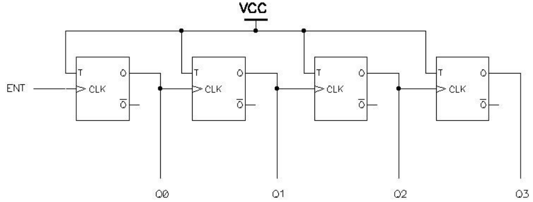
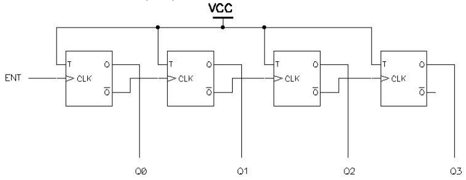

# Contadores

**Fecha:** 13-10-2026

## Introducción

En esta clase nos concentraremos en un caso particular de un circuito secuencial: el contador. Éste es un circuito cuyas salidas representan, en un código binario dado, la cuenta de la cantidad de cambios en su entrada, módulo su capacidad.

Usualmente se utilizan contadores binarios (que usan el código binario para representar números naturales), aunque se pueden diseñar contadores que utilicen el código Gray, el entrelazado 2 de 5, el decimal empaquetado o cualquier otro que se pueda considerar. Normalmente cuentan las transiciones de la entrada de 0 a 1 (flancos ascendentes). No tienen que empezar en 0, ni su módulo tiene porque ser una potencia de 2.

## Contador en base a flip-flops T

La manera más simple de construir un contador es a partir de flip-flops T, de la siguiente manera:

**Recordatorio:** El flip-flop T es aquel que mantiene la última salida si T=0 y la invierte si T=1.

Para analizar el comportamiento del circuito supongamos que inicialmente todas las salidas de los FF están en 0; dividiremos el análisis en los flancos que se generan.

- **Primer flanco:** Al pasar ENT de 0 a 1, genera un flanco ascendente en la entrada de reloj del primer FF, por lo que su salida Q0 pasará a 1. Esto a su vez genera un flanco ascendente en el segundo FF, llevando su salida Q1 a 1.Esto continua hasta el último FF de forma análoga.

    $$
    \begin{array}{cc|c|c|c}
    &\text{Q3}&\text{Q2}&\text{Q1}&\text{Q0}\\
    \hline
    \text{Inicial}&0&0&0&0\\
    \text{1° flanco}&1&1&1&1\\
    \end{array}
    $$

- **Segundo flanco:** Al ocurrir el segundo flanco, el primer FF vuelve a cambiar, pero no genera un flanco ascendente en la entrada del reloj del segundo, por lo que éste resta incambiado, al igual que el resto de la cascada.

    $$
    \begin{array}{cc|c|c|c}
    &\text{Q3}&\text{Q2}&\text{Q1}&\text{Q0}\\
    \hline
    \text{Inicial}&0&0&0&0\\
    \text{1° flanco}&1&1&1&1\\
    \text{2° flanco}&1&1&1&0\\
    \end{array}
    $$

- **Tercer flanco:** Al ocurrir el tercer flanco, el primer FF vuelve a cambiar, la que pasa a 1. Esto si genera un nuevo flanco ascendente en el segundo FF que lleva a cambiar su salida Q1 a 0. Como esto no genera un flanco ascendente, el resto de los FF permanece igual
    
    $$
    \begin{array}{cc|c|c|c}
    &\text{Q3}&\text{Q2}&\text{Q1}&\text{Q0}\\
    \hline
    \text{Inicial}&0&0&0&0\\
    \text{1° flanco}&1&1&1&1\\
    \text{2° flanco}&1&1&1&0\\
    \text{3° flanco}&1&1&0&1\\
    \end{array}
    $$

Con esto nos podemos hacer una idea de como funciona el circuito, resultando en la siguiente tabla completa:

$$
\begin{array}{cc|c|c|c}
&\text{Q3}&\text{Q2}&\text{Q1}&\text{Q0}\\
\hline
\text{Inicial}&0&0&0&0\\
\text{1° flanco}&1&1&1&1\\
\text{2° flanco}&1&1&1&0\\
\text{3° flanco}&1&1&0&1\\
\text{4° flanco}&1&1&0&0\\
\text{5° flanco}&1&0&1&1\\
\text{6° flanco}&1&0&1&0\\
\text{7° flanco}&1&0&0&1\\
\text{8° flanco}&1&0&0&0\\
\text{9° flanco}&0&1&1&1\\
\text{10° flanco}&0&1&1&0\\
\text{11° flanco}&0&1&0&1\\
\text{12° flanco}&0&1&0&0\\
\text{13° flanco}&0&0&1&1\\
\text{14° flanco}&0&0&1&0\\
\text{15° flanco}&0&0&0&1\\
\text{16° flanco}&0&0&0&0\\
\end{array}
$$

Y como vemos a partir del dieciseisavo flanco la secuencia se repite.

**Observación #1:** Para tener un mayor número de bits (y por lo tanto mayor capacidad de cuenta) basta con agregar más flip-flops T conectados de manera análoga. Por cada flip-flop que se agrega se duplica la capacidad de cuenta.
**Observación #2:** Si quisieramos que la cuenta fuera ascendente, deberíamos usar el siguiente esquema de conexión de los flip-flops:

## Contador en base a flip-flops D

En esta sección presentamos una metodología para el diseño de contadores usando flip-flops tipo D sincrónicos por flanco.

Para analizar como diseñar un contador de estas características, vamos a proponernos construir un contador ascendente que cuente en código Gray entre 1 y 10. Si bien es un ejemplo puntual, la metodología que desarrollaremos se puede aplicar al diseño de cualquier otro contador.

**Nota:** El código Gray es un sistema de numeración binaria donde dos valores sucesivos se diferencian en un solo bit.

Dada la especificación, lo primero a determinar es la cantidad de flip-flops que vamos a necesitar. Para ello veamos como se va construyendo un código Gray:

$$
\begin{array}{c}
0\\
1\\
\hline
11\\
10\\
\hline
110\\
111\\
101\\
100\\
\hline
1100\\
1101\\
1111\\
1110\\
1010\\
1011\\
1001\\
1000\\
\end{array}
$$

Notemos que el código se genera espejando lo ya hecho hasta los lugares "potencia dos" (indicado por las separaciones) agregándole un 1 delante.
Si tomamos arbitrariamente, que el primer código representa el 0, nos queda la siguiente tabla de codificación.

$$
\begin{array}{cc}
0&0000\\
1&0001\\
2&0011\\
3&0010\\
4&0110\\
5&0111\\
6&0101\\
7&0100\\
8&1100\\
9&1101\\
10&1111\\
11&1110\\
12&1010\\
13&1011\\
14&1001\\
15&1000\\
\end{array}
$$

Para el caso que nos ocupa, tomaremos los códigos binarios desde el 1 al 10.
Precisamos 4 dígitos para representar los códigos Gray de estos números, por lo que nuestro contador requiere de 4 FF.

En el siguiente paso, escribimos una tabla que nos indique en función del valor actual de los FF (Q3, Q2, Q1, Q0), cual debe ser el nuevo valor de forma que el circuito se comporte como deseamos:

